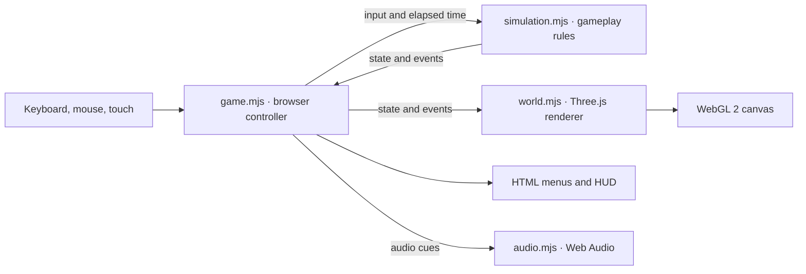

# Immune Protocol

A browser FPS about a nano-soldier injected into a patient. Defend two or three tissue nodes in each of ten missions. Place an auto-turret to cover one approach while you defend the others. The campaign starts in the bloodstream, then moves through the lungs, stomach, small intestine, colon, a lymph node, the inner ear, and the brain.

[Play on GitHub Pages](https://corycowgill.github.io/ImmuneProtocol/) · [Play online co-op](https://immune-protocol-coop.onrender.com/) · [Watch the demo](https://corycowgill.github.io/ImmuneProtocol/demo/)

## Run locally

You’ll need Node.js with npm, Python 3 on your `PATH` as `python`, and a browser that supports WebGL 2. From the repository root:

```sh
npm run dev
```

Open [http://127.0.0.1:8017](http://127.0.0.1:8017). The command serves `dist/` with Python’s static file server. Three.js and the game assets are included, so there’s no dependency install or build step. For a deployment, serve `dist/` from a static host. Run `npm run check` to check the game and intro scripts for JavaScript syntax errors. A recorded demo is available at [/demo/](http://127.0.0.1:8017/demo/) while the local server is running.

The Hallucinated Games studio intro plays before the main menu. Use Skip intro, press Escape, or open the game with `?nointro` to go straight to the menu.

Your first Arterial Junction deployment begins with one guided breach. Shoot the bacillus off the tissue, move into repair range, and hold Repair until the wound seals. The second node and turret become available as the rest of Wave 1 begins. The browser remembers completed training for later deployments.

The title screen lists every mode in one menu and an operator card that shows your campaign route, best score, difficulty and equipped weapons. Choose **Start campaign** (or **Continue campaign**) to open the deployment briefing: the mission route with secured and locked missions, the arena, its waves, tissue nodes and hazard, the pathogens you will face, and your difficulty, field upgrade and loadout, with a shortcut to the Armory. Select **Begin campaign** to deploy. Between missions, equip one field upgrade. Your browser saves completed missions and the chosen upgrade at each checkpoint. **Continue campaign** shows the next mission and takes you back to its start. The final report shows the tissue preserved in all ten missions, total score, and pathogens neutralized.

| Field upgrade | Effect |
| --- | --- |
| Fast Sealer | Restores 18 tissue points per repair pulse. |
| Deep Magazine | Adds 12 rounds to the equipped magazine. |
| Insulated Suit | Reduces suit damage from stomach acid, intestinal pressure waves, and haustral squeezes by 40%. |
| Turret Stabilizer | Extends the turret's slow from 1.4 to 2.2 seconds. It still fires every 2.6 seconds. |

**Free Mode** opens the same deployment briefing with every mission available. Select a mission, set difficulty, field upgrade and loadout, then select **Deploy**. Free Mode runs leave your campaign checkpoint, mission progression, and best score intact. Reaching the Mega Virus in Neural Cortex in either mode unlocks **Practice Mega Virus**, which starts directly at Wave 3 with fresh supplies.

Every wave fields three times the pathogens it was first written with, arriving slightly further apart, and each strike on tissue or on your suit does proportionally less damage. Your score and kills are shown in the top right during a mission.

Missions give you reasons to leave your node. From the second wave on (the first in two-wave missions), a **brood nest** takes root on the far side of the arena and hatches a fast larva every few seconds, up to eight; the last wave roots two. A wave is not clear until every nest is destroyed, and the player who destroys one scores 600. Partway through each wave an **antibody cache** drifts in for 45 seconds: the first suit to reach it gets 40 suit integrity, a full magazine and 250 score. Both are marked on screen, with an arrow at the screen edge when they are out of view. The nest is its own model: a mound of egg sacs bedded in dark tissue, some already torn open, gripping the floor with roots. `tools/enemies/build_nest.py` sculpts it in Blender from metaballs, spheres and tapered curves, and `blender -b -P tools/enemies/process.py -- nest` bakes it into `dist/assets/enemies/nest.glb` like the scanned pathogens. The training breach, Heart Valve, Capillary Junction and the Mega Virus keep their own scripted objectives.

Pathogens no longer file straight in. Lungers and spitters swing wide on the approach and arrive from several sides, keep clear of each other, and dart sideways for a moment when you hold them in your crosshair before they have to recover. A third of them reconsider their target every few seconds and switch to the most damaged node or one no suit is guarding. Spitters sidestep after each shot at a suit.

Every arena is a third larger in each direction than it was first laid out: the playable floor is 110 × 154 m, with tissue nodes 40–60 m apart. Suits move about 20% faster to match. The artery floor is broken up by ten clots that block movement and line of sight for you and force pathogens to flow around them, and each organ arena has more of its own obstacles. The Heart Valve keeps its original chamber. `npm run profile`, then `/__overview`, draws a top-down plan of every arena with its nodes, inlets, obstacles and hazard zone.

## Weapons

You carry two weapons, a primary and a secondary, from the first mission. Pick any two different weapons in the **Armory**. Switch between them with **1** and **2**, the mouse wheel, **Y** on a controller, or the **Swap** button on touchscreens. Each weapon keeps its own magazine when you switch. Drawing a weapon takes a moment, and you can't fire until it's up.

| Weapon | Role | How it plays |
| --- | --- | --- |
| Needle Carbine | Assault | Accurate automatic fire, 30 rounds. The default primary. |
| Lancet Rifle | Sniper | 110 damage per bolt-action shot, once a second, 5 rounds. Deep zoom and a scope overlay when aimed, with near-perfect accuracy; wild from the hip. |
| Burst Scattergun | Shotgun | Nine pellets per shell, 6 shells. Devastating up close; damage falls off sharply past 7 m and bottoms out at 22 m. |
| Phage Launcher | Rocket | Two rockets that fly visibly and burst on impact, splashing every pathogen within about 5 m (Shellback armor doesn't stop splash). Very slow 3.9 s reload. |
| Sting Pistol | Sidearm | Light 11-damage rounds at 830 rounds a minute, 16 per magazine, half-second reload, and a little extra move speed. The default secondary. |

Every weapon spreads its shots in a cone. Aiming down sights (hold right click or LT) narrows the cone and zooms in, and the crosshair widens and narrows with the current spread. The Lancet's scope zooms furthest.

The **Armory** is a gunsmith bench with three tabs. The weapon sits on a large stage (drag to rotate it) above stat bars for the current build. **Weapons** picks your primary and secondary. **Gunsmith** pins a callout to each attachment point on the weapon — barrel, muzzle, optic, receiver and magazine; pick one to list its three options, each with a picture and its gains and losses. **Customize** covers finish, accent, skin, decal, sticker and charm. Pointing at or focusing any option previews its effect on the stat bars in green and red before you equip it. Parts change damage, fire rate, spread, zoom, capacity, and reload speed, scaled to each weapon. Each weapon also has its own cosmetics:

- **Body finish** and **accent color**.
- **Skins** that wrap the polymer furniture in a pattern: Tiger, Zebra, Winter camo, Woodland camo, Urban digital, Carbon fiber, and the glowing Cyberpunk and Molten core. The body finish still colors the metal.
- **Decals** printed along the side: Racing stripes, Hot rod flames, Kill tally, Hazard chevrons, Circuit traces, Barcode, Unit 07, or Paint splatter. On the Phage Launcher they wrap around the tube.
- **Stickers** printed on the receiver: Biohazard, Happy virus, Voltage, Big heart, Pathogen skull, Gold star, Hallucinated crest, Double helix, Antibody, Hot shot, Snowflake, Tiger paw, Crosshair, Lab cat, Pizza slice, Rainbow, or Peace.
- **Charms** that dangle and swing beside your support hand and buff the weapon while it's in your hands:

| Charm | Buff | Effect |
| --- | --- | --- |
| Lucky clover | Luck | Critical hit zones 30% larger |
| Macrophage fang | Strength | +10% damage |
| Quicksilver hourglass | Reload speed | Reloads 20% faster, swaps 25% faster |
| Flagellum feather | Movement speed | +8% move speed |
| Steady eye | Accuracy | 30% tighter spread |
| Ration capsule | Capacity | 25% larger magazines |
| Gambler's die | Fortune | Critical hit zones 18% larger, +4% damage |
| Antibody | Precision | +6% damage, 10% tighter spread |
| Frost crystal | Composure | Reloads 10% faster, 12% tighter spread |
| Heart locket | Agility | +5% move speed, swaps 20% faster |
| Tiger claw | Ferocity | +7% damage, critical zones 10% larger |
| Berserker skull | Fury | +15% damage, but 12% wider spread |
| Spare cell | Endurance | 15% larger magazines, reloads 8% faster |
| Shooting star | All-rounder | +3% damage, 5% faster reloads, +3% move speed, 5% tighter spread |

The five weapon bodies are hard-surface models built in Blender by `tools/weapons/build_weapons.py` (`blender -b -P tools/weapons/build_weapons.py -- [weapon ...] [--render]`, with `gltfpack` on your `PATH` or `GLTFPACK` pointing at its npm `cli.js`). Each one is modeled in the game's own coordinates from sculpted side profiles, extruded cross-sections and lathed parts, with boolean cuts for ports, vents, slots, serrations and engraved roll marks, then bevelled and given weighted normals. Cycles bakes ambient occlusion and a curvature edge-wear mask into a 2K atlas per weapon (`dist/assets/weapons/<weapon>-weathering.webp`), so crevices darken and paint wears to bare metal on the edges in the game. Materials are named after the game's weapon kit roles, so finishes, accents and skins apply to the models, while barrels, muzzles, optics, receivers and magazines stay swappable procedural parts. The startup screen waits for all five models and weathering atlases; if one cannot load, it reports a preparation failure and offers a retry.

Builds for all five weapons are saved in the browser and work alongside your field upgrade. Older saved carbine builds carry over. Every weapon has unlimited reserve ammunition. The armory is open from the title menu, the deployment briefing and the report between missions; it stays closed during a mission, where each wave is followed by a short countdown to the next. Missions start with the primary. First-time Arterial Junction training uses the stock carbine until the guided breach is sealed. In online co-op each player brings their own two weapons; teammates see your shots, rockets, and explosions.

The game opens with an illustrated lab loading screen before the title menu becomes available. Its progress bar reports completed preparation work, with rotating dispatches from the lab. The studio intro can play over preparation; skipping it still waits for preparation to finish. Startup downloads and decodes every weapon, pathogen and suit model, the baked lab, portraits, audio and menu art; prepares the lab renderer and every suit-picker portrait; builds all ten arenas, hazards, cosmetic textures and weapon part cards; and uploads textures and compiles shaders on the actual game renderer, including rockets, explosions, repair effects, co-op suits and the Mega Virus encounter. Required models or artwork that fail to load leave a retry screen instead of enabling deployment with missing assets.

Each deployment, restart and mission transition has its own loading screen. It exercises arena effects and both carried weapons, pre-renders at the selected display resolution and waits for the GPU before releasing control. Solo simulation time starts after this preparation. In co-op the server remains authoritative while each client prepares its graphics. Combat reuses bounded pools of smoke, fireballs, shockwaves, rockets and tracers, and retains up to twelve idle rigs per pathogen species to reduce repeated allocation and shader setup. At effect-pool saturation only decorative visuals are omitted; combat damage stays in the simulation.

When the frame rate drops below about 50 fps the game renders at a lower resolution, down to 60% per axis, and sharpens again once it has headroom. Run `npm run profile` and open `/__profile` on the printed address for per-arena draw calls, triangles and CPU time.

Run `npm run test:render` for resource reuse and reset regression tests. Run `npm run verify:loading`, open the printed local URL, and wait for the browser report to exercise every arena and weapon with combat effects and report preparation time, render CPU time, GPU resource counts and any asset requests after upfront renderer preparation. This synthetic check does not replace long gameplay sessions or GPU profiling. Heavy scenes can still be limited by model complexity, transparency, resolution and hardware; Low graphics remains available in Settings.

## Difficulty

Choose **Easy**, **Medium**, or **Hard** on the deployment briefing. Hover, focus, or select an option to see exactly what it changes. The choice is saved in the browser and applies when each campaign or Free Mode mission starts, so you can change it between missions. The pause screen and mission report name the difficulty you're playing. Medium is the standard balance that every mission is tuned around.

| | Easy | Medium | Hard |
| --- | --- | --- | --- |
| Pathogens per wave | One in three removed | Standard | One extra for every seven, except in Gastric Chamber |
| Spawn timing | 30% slower | Standard | 10% faster |
| Pathogen and Mega Virus health | −25% | Standard | +15% |
| Tissue damage | −35% | Standard | +10% in two-node arenas, standard in three-node arenas |
| Suit damage, including hazards | −40% | Standard | +15% |
| Tissue restored per repair pulse | +30% | Standard | −15% |
| Auto-turret placements | Two, so you can move it once | One | One |

Capillary Junction thins or reinforces each surge but always keeps the pathogen that triggers its forecast, and Overtime follows the same rules. The Heart Valve colony and flank patrol, the bronchus and gastric counterattacks, the lower-passage flank, and the Mega Virus brood keep their numbers and timing; only their health and damage change. Online co-op always plays Medium. The best score on the main menu counts runs from every difficulty.

Run `npm run balance` to play every mission headlessly with two scripted strategies on each difficulty. The anchor guards the weakest node. The rover runs to the node under the most pressure and switches targets when Shellbacks block its shots. The script prints win rates and the lowest tissue integrity per run, and exits with an error if a mission is never won on some difficulty. Narrow it with `npm run balance -- --difficulty hard --trials 20 stomach colon`.

## Pathogens and the disease guide

Open **Disease guide** on the main menu to browse every pathogen. Each entry shows its animated 3D model (drag to turn it, or choose **Provoke** to see its attack windup), a description and counter tactics, its health, speed, damage and score, the missions it attacks in, and three facts. The stats and mission lists come straight from the simulation, so they stay current.

Every pathogen fights with one of three behaviors. Lungers coil, then leap at a fixed landing point. Latchers ignore your suit, grab a tissue node and tear. Ranged pathogens hang back and spit.

| Pathogen | Behavior | First seen in |
| --- | --- | --- |
| Crown Virus | Lunger | Arterial Junction |
| Spitting Spore | Ranged | Arterial Junction |
| Bacillus | Latcher | Arterial Junction |
| Valve Colony | Stationary, fight it through the valve | Heart Valve |
| Phage Lander | Lunger, lighter and quicker | Arterial Junction, Wave 4 |
| Filovirus | Latcher, tears a little faster | Arterial Junction, Wave 4 |
| Blister Mortar | Ranged, tougher than a spore | Arterial Junction, Wave 5 |
| Shellback | Latcher with an armored front | Bronchial Fork |
| Splitter | Lunger that splits in two on death | Bronchial Fork |
| Whiptail | Lunger, sturdier and harder hitting | Gastric Chamber |
| Amoeba | Latcher, slow and very tough | Gastric Chamber |
| Rogue Cell | Latcher, hits hard | Lymph Node |

The pathogens are photoreal 3D scans processed in Blender by `tools/enemies/process.py` (Blender 4.2 LTS or newer, plus `gltfpack`, for example `npx gltfpack`). Put the source scans in `tools/enemies/originals/` (they are not committed; `originals/manifest.json` records each file's size and SHA-256), then run `blender -b -P tools/enemies/process.py -- [species ...]`. Set `GLTFPACK` to the `gltfpack` binary or its npm `cli.js` if it isn't on your `PATH`. `tools/enemies/enemies.json` maps each species to its scan and sets its triangle budget, material and motion. For each species the script:

- Welds the scan, removes reconstruction floaters, and scales it to a unit radius.
- Rebuilds a clean surface with a voxel remesh and decimates it to about 14k–24k triangles. Open shells skip the remesh. The Valve Colony, which appears once, keeps a lighter decimation of the scan and its own UVs.
- Bakes 1K albedo, ORM and normal maps from the full scan, with a fine pore bump for micro detail, then darkens crevices with the baked occlusion. The material adds clearcoat and sheen for a wet, living look.
- Adds morph-target animation: a looping **Idle** clip (Breathe plus three sway targets that make spikes, tendrils, legs and flagella writhe while the body breathes) and a **Clench** target that the game drives from each attack windup.
- Exports `dist/assets/enemies/<species>.glb` and renders a Cycles portrait for the guide to `dist/assets/enemies/portraits/<species>.webp`.

All pathogen models load while the startup screen prepares the arenas. A missing model keeps the game behind the retry screen. The renderer retains its plain membrane placeholder as a defensive fallback for unexpected unknown species. `npm run test:coop` also checks that every species has a model, animation targets, a portrait, a guide entry and at least one mission.

## Online co-op

Two or three players share all ten missions in one room, from Arterial Junction to the Mega Virus fight in Neural Cortex. On the multiplayer server's game page, open **Online co-op**, enter a callsign, and choose **Create room**. Send the invite link to one or two friends. They open it, enter callsigns, and choose **Join room**. The room holds up to three players and starts when all joined players choose **Ready**, with a minimum of two. Invite a third player before the pair readies up; matches do not accept new players after deployment.

After each mission, all players ready up at the shared checkpoint. A win unlocks the next deployment in the room, while a loss lets the squad retry the current mission. Each deployment starts with fresh suits and supplies and keeps every player’s weapon loadout. The squad extracts after stabilizing Capillary Junction and earns a combined campaign report after the final boss. Campaign progress belongs to the active room.

In the lobby, each player picks a suit: **Vanguard** (heavy assault armor), **Wraith** (stealth infiltrator), **Lifeline** (field corpsman), or **Bathysphere** (deep-dive pressure suit). Once you're in a room, the lobby becomes a full-screen miniaturization lab in a futuristic hospital: all joined players stand in their suits on the reduction pads of the shrinking machine, beside a holographic patient with the injection site marked, the injection capsule and live operator consoles. A ready player's pad lights up, and when the squad is ready the machine charges. Your teammates see your suit during missions. Suits can be changed in the lobby or at a mission checkpoint, and the browser remembers your choice.

The lab is modelled in Blender by `tools/lobby/build_lab.py` (`blender -b -P tools/lobby/build_lab.py -- [--samples N] [--size N] [--preview]`, with `gltfpack` on your `PATH` or `GLTFPACK` pointing at its npm `cli.js`). Faces the lobby camera can never see are culled, then Cycles bakes the full lighting (direct, bounced and glossy) into three tone-mapped atlases, for the room, the machine and the emitter ring (`dist/assets/lobby/lab-<part>.webp`, with the geometry in `lab.glb`). The game draws the lab unlit from those bakes so it matches the scanned suits, and adds what moves on top: the squad, ready beams and pad rings, the emitter's spin and charge, the operator screens, the hologram patient and the capsule glass. A bake takes about an hour on the GPU at the default 2K and 160 samples.

Each suit has its own two weapons, builds, ammo, and health. Co-op missions always use the Medium difficulty. You share the tissue nodes, one turret, the wave timer, and the mission score. If one suit goes down, it returns at the next wave if a surviving teammate clears the current one. Waves follow each other after a short countdown; the armory is available in the lobby and at the checkpoint between missions. The game keeps a score for each player — points for the pathogens they neutralize and the tissue they repair — and shows it on screen beside the team total, in the mission report, and as campaign totals when the campaign ends. Wave-clear bonuses and turret kills count toward the team score only. The game holds your place for up to 75 seconds after a disconnect.

To test locally with two or three browser windows, run these commands from the repository root with Node 22 and npm. Open the resulting game at [http://127.0.0.1:8017](http://127.0.0.1:8017) and share its invite between the windows.

```sh
npm ci
npm run serve:coop
```

Run `npm run test:coop` to exercise the server with two- and three-player WebSocket clients. The four suits are TRELLIS-generated 3D scans, processed by the Blender pipeline in `tools/trellis/` (Blender 4.2 LTS or newer, plus `npm i -g gltfpack`). `tools/trellis/run_pipeline.sh [suit ...]` runs every stage: download the source GLBs from their iCloud shares and validate them, identify which file is which suit, render untouched baselines, refine a master, render enhanced versions, then build, test, and report on the runtime GLBs.

- **Sources.** `download.py` resolves each iCloud share (`sources.json`), validates the GLB structure, and records the size and SHA-256 in `originals/manifest.json`. Originals are read-only and are only replaced with `--force` when the remote file changes.
- **Identification.** `identify.py` scores colour, texture, palette, and silhouette against `tools/suits/reference/` over all 24 assignments. It writes `mapping.json` only when the mapping is unambiguous.
- **Master.** `process.py master` keeps the scanned geometry. It only welds seam-split vertices, removes degenerate faces and tiny floaters, fixes winding, and smooth-shades by angle. It re-derives roughness and metallic per material class while keeping the source's own variation, and bakes ambient occlusion. Masters are saved to `masters/<suit>.blend`.
- **Runtime.** `process.py runtime` decimates a copy to about 45k triangles, re-unwraps it, and bakes 2K albedo, ORM, and normal maps from the master. It then lowers the T-posed arms at the shoulder and cuts the mesh into the 15 rigid joints of the game's teammate rig, with the suit's own joint pivots stored as glTF extras. The result is exported to `dist/assets/suits/<suit>.glb` and checked by `verify_export.py`.

Studio renders, QA images, and `reports/REPORT.md` cover each suit. The startup screen loads every suit GLB, prepares the lab renderer and suit-picker portraits, and uploads suit textures before showing the title. Gameplay never starts a suit download; a missing suit keeps startup behind its retry screen. The server runs the shared simulation on a fixed tick, validates player input, and sends the result for each client to draw in Three.js.

### Host online co-op on Render

1. Open [Deploy Immune Protocol to Render](https://render.com/deploy?repo=https%3A%2F%2Fgithub.com%2Fcorycowgill%2FImmuneProtocol) and sign in. If asked to connect GitHub, grant Render access to the `ImmuneProtocol` repository.
2. Review the Blueprint and deploy the **immune-protocol-coop** web service. [render.yaml](render.yaml) specifies Node 22 through `package.json`, the Free plan in Ohio, branch `main`, and the build and startup commands.
3. Wait for the service to show **Live**, then open its `.onrender.com` game URL. Both players use that address. The `/healthz` endpoint responds when the game server is ready.

The Free service can take about a minute to wake after 15 minutes of inactivity. Rooms live in the running server's memory and expire on redeploy or restart. See [Render's Free plan documentation](https://render.com/docs/free).

## Campaign missions

Arenas are about twice the floor area they used to be, so tissue nodes sit 30 m or more apart and pathogens enter 20 m or more from the node they attack. Tissue organs, villus groves, biofilm mounds and crystal clusters block movement and give cover. When the last pathogen of a wave dies, a short countdown runs before the armory or mission report opens, so you can see the area clear.

| Mission | What to watch for |
| --- | --- |
| Arterial Junction | Learn to intercept attackers and repair the core before defending three nodes through five waves, under a river of red blood cells pumped through a beating valve. |
| Capillary Junction | Read the Amber and Teal attack forecasts, deploy support between waves, and choose whether to stay for Overtime. |
| Heart Valve | Shoot the colony through the open valve and defend the Septal Node against flank attacks. |
| Bronchial Fork | Survive three waves, reopen both bronchi, and keep them open through a full breath. |
| Gastric Chamber | Close the intake and drain the acid basin under fire, then defend the newly exposed lower passage. |
| Intestinal Bend | Defend three nodes in a swaying villus forest and move into the side channels to evade the pressure wave. |
| Colonic Reservoir | Hold three nodes in the microbiome while haustral squeezes sweep the chamber from side to side. |
| Lymph Node | A patrolling macrophage digests every pathogen it touches, and crushes suits. Lure infections into its path while you hold three nodes. |
| Inner Ear | Place your turret outside the resonance zones to keep it firing. Resonance rotates between three nodes. |
| Neural Cortex | Survive two waves, then fight the Mega Virus as its connected bodies take turns exposing their cores. |

## Publish updates

GitHub Pages serves the root of `gh-pages`. After committing game changes to `main`, publish the contents of `dist/` by running this command from `main`:

```sh
git subtree push --prefix=dist origin gh-pages
```

## Controls

| Action | Keyboard and mouse | Xbox controller |
| --- | --- | --- |
| Move | WASD | Left stick |
| Look | Mouse or arrow keys | Right stick |
| Fire | Left click or Space | Hold RT |
| Aim | Hold right click | Hold LT |
| Sprint | Shift | Click the left stick |
| Reload | R | X |
| Repair | Hold E near a damaged tissue node or open gash | Hold LB |
| Deploy or redeploy auto-turret | Q | RB |
| Switch weapon | 1 / 2 or mouse wheel | Y |
| Pause | Esc or P | Menu ☰ |

When mouse capture is unavailable, drag the view to look. On touchscreens, move with the joystick, drag to look, and use the action buttons.

Connect an Xbox controller to your device and press a button with the game tab focused. Use the D-pad or left stick to navigate menus, **A** to select, and **B** to go back. In Capillary Junction, the D-pad chooses support during the wave break. Left reinforces Amber, right reinforces Teal, up selects Load magazines, and down selects turret redeployment. If your browser gates audio, click the game or press a keyboard key once to enable it. Enter co-op callsigns and room codes with your keyboard.

Each node has its own integrity meter and direction marker. Losing any node ends the mission. You can deploy one turret per mission on clear ground ahead of you, or place it twice on Easy. It stays where you place it and fires one shot every 2.6 seconds at targets within about 12 meters. Hits damage and briefly slow pathogens. Put it near an approach to the node you plan to leave.

The pause screen shows the wave, score, tissue and objective, and offers **Restart mission**, Settings, the field manual, and **Quit to main menu**, which asks you to press it twice. Settings is available from the main menu and pause screen, with look sensitivity, graphics quality, and music and effects volume. Look sensitivity applies to mouse, touch, and the Xbox right stick. Low graphics reduces rendering load on slower devices. All settings are saved in the browser.

Viruses coil before lunging toward a fixed landing point. Spores swell before spitting a slow projectile. Step sideways during the windup to evade either attack. Bacilli head straight for the tissue, brace, and tear until you dislodge them.

Shellbacks guard their front. Aim for exposed tissue from the side or rear. Splitters break into two smaller attackers on death, so keep the area in sight after the first kill.

Capillary Junction has three waves with staggered attacks. The HUD names the next targeted node, the incoming pathogen, and the time until it enters. In Wave 3, an Amber virus rush arrives six seconds before the Teal bacillus breach.

During each break, use **1** to reinforce Amber, **2** to reinforce Teal, **3** to start the next wave with a full magazine, or **4** to redeploy a turret you've already placed. You can also select the options on screen. Reinforcement starts when the first attacker enters the chosen inlet. After choosing redeploy, face clear ground and press **Q** or tap **Turret** before the next wave. A successful move uses your support choice for that break. The turret keeps its position until you find a valid new spot.

In the breach wave, a bacillus tear can leave a gash that keeps draining tissue after the attacker dies. Move to the marked wound and hold Repair. Completed sealing pulses stay applied when you stop to fight or dodge. If a gash is still open after the last enemy falls, seal it to extract.

After securing Capillary Junction, choose **Extract** to bank the result or **Stay for overtime**. Both nodes, your remaining suit health and ammo, and your turret carry into overtime. Stop the Teal breach, clear the Amber spore pressure, and seal any gash to earn 2,000 bonus points. If you lose in overtime, retry Capillary Junction from Wave 1.

In Heart Valve, fire through the opening to hit the colony. Use each closed window to repair the valve wound. The outer wall can be repaired at any time. The mission ends when the colony and flank threats are gone and both nodes are restored. Unlocks are saved in the browser.

In **Bronchial Fork**, move to each blocked bronchus after the third wave and hold Repair to reopen it. Completed pulses carry over while you stop to fight. Once both bronchi are open, keep both tissue nodes at **45% integrity or higher** through one full breath. If integrity drops below 45%, that side clogs again. Watch the exhale timer when crossing the central airway, and clear any surviving pathogens before leaving.

In **Gastric Chamber**, clear the first wave, then hold Repair at the intake on the west bank. Closing it diverts acid into the drain channel. Cross to the east bank and hold Repair at the drain valve. Completed pulses carry over if you stop to fight. Once the basin empties, watch the lower passage behind the insertion point. The final wave uses it to flank both tissue nodes.

The **Mega Virus** is Neural Cortex's third wave. Its connected membranes protect three cores. Follow the pulse to the core about to open, then shoot the exposed tissue. When the shell closes, clear spawned viruses, reload, and repair. Neural overload blocks repairs at the highlighted node during exposure. In the final phase, Shellbacks and Splitters pressure opposite sides. Clear any survivors after the boss falls.

The original soundtrack fades between **Arterial Drift** in the menu and between waves, and **Immune Response** during combat. It starts after you interact with the game. The speaker button mutes both the soundtrack and sound effects.

## Architecture

Solo missions run in the browser. The controller collects input, advances the simulation on each frame, then uses the resulting state to draw the arena, update the HUD, and play audio. During online co-op, the controller sends input to the Node server, which runs the authoritative simulation at 30 ticks per second. The browser predicts local movement and interpolates state updates for other actors.



| File | Responsibility |
| --- | --- |
| [`dist/index.html`](dist/index.html), [`dist/styles.css`](dist/styles.css) | Menus, HUD, canvas, and touch controls. |
| [`dist/game.mjs`](dist/game.mjs) | Input, mouse capture, frame timing, and screen transitions. Browser storage remembers campaign checkpoints, mission unlocks, best score, training completion, and player settings. |
| [`dist/simulation.mjs`](dist/simulation.mjs) | Movement, shooting, lane and node targeting, turret behavior, wave progression, scoring, and repair. It runs independently of the DOM and Three.js. |
| [`dist/coop-simulation.mjs`](dist/coop-simulation.mjs) | Per-suit state and shared wave rules for two or three players. |
| [`server/rooms.mjs`](server/rooms.mjs), [`dist/coop-client.mjs`](dist/coop-client.mjs) | Match rooms, WebSocket transport, reconnects, and client-side prediction. |
| [`dist/world.mjs`](dist/world.mjs) | Arena geometry, lighting, atmosphere, enemies, and effects. The missions share the renderer and switch anatomy and lighting when the area changes. |
| [`dist/organs.mjs`](dist/organs.mjs) | Mission data for the seven organ missions, including node coordinates, spawn inlets, solid obstacles, wave compositions, and hazard timings. |
| [`dist/organ-world.mjs`](dist/organ-world.mjs) | Procedural anatomy, organ-specific materials, and animated hazard geometry. |
| [`dist/level-props.mjs`](dist/level-props.mjs) | Set dressing and ambient VFX: red-blood-cell rivers and a pumping valve gate, neutrophil patrols that engulf bacteria, the villus forest, the colon microbiome, the lymph-node macrophage, the firing neural web, obstacle props, and light shafts. |
| [`dist/bio-textures.mjs`](dist/bio-textures.mjs) | Tileable red cell, mucosa, biofilm, neural, and leukocyte surface maps generated at load time. |
| [`dist/level-hud.mjs`](dist/level-hud.mjs) | The third node readout and marker, the wave-clear countdown banner, the main menu's difficulty picker, and Free Mode cards whose previews are rendered while the arenas load. |
| [`dist/difficulty.mjs`](dist/difficulty.mjs) | Easy, Medium, and Hard settings, their menu descriptions, per-mission exceptions, and the rules that reshape a solo mission's waves when it starts. [`tools/balance/balance-bot.mjs`](tools/balance/balance-bot.mjs) checks that every mission stays winnable. |
| [`dist/brain-boss.mjs`](dist/brain-boss.mjs), [`dist/mega-virus.mjs`](dist/mega-virus.mjs) | The finale's phase rules, physical shot gates, and connected 3D creature. |
| [`dist/carbine.mjs`](dist/carbine.mjs) | The 3D carbine and armored gloves, including modular parts, finishes, and articulated reload poses. |
| [`dist/weapon-mods.mjs`](dist/weapon-mods.mjs), [`dist/armory-art.mjs`](dist/armory-art.mjs) | The five weapons, their parts, stickers and charms, the two-weapon loadout and its saved-build validation, and armory images rendered from the same 3D parts used in combat. |
| [`dist/arsenal-models.mjs`](dist/arsenal-models.mjs), [`dist/arsenal-ui.mjs`](dist/arsenal-ui.mjs) | 3D models for the sniper rifle, shotgun, rocket launcher, and pistol with every part variant, receiver stickers and swinging charms; the weapon strip, spread crosshair, scope overlay, swap controls, and armory loadout picker. |
| [`dist/explosions.mjs`](dist/explosions.mjs) | Rocket flights with smoke trails, and explosions with a fireball, flash, smoke column, ground shockwave, sparks, light, and camera shake. |
| [`dist/repair-tool.mjs`](dist/repair-tool.mjs) | The 3D tissue sealer that replaces the carbine while the player repairs the wound. |
| [`dist/heart-valve.mjs`](dist/heart-valve.mjs) | The moving valve and attached colony. The scene follows the same timing as the simulation's shot and repair windows. |
| [`dist/turret.mjs`](dist/turret.mjs) | The 3D auto-turret with its aiming mount, deployment animation, and recoil. |
| [`dist/audio.mjs`](dist/audio.mjs) | Mixes original [sound effects](dist/assets/sfx) and two synchronized [soundtrack loops](dist/assets/music). Impacts and inlet activity pan with their position relative to the player. |

## How it was built

The artery is a real-time 3D scene. Code builds the vessel branches, membrane folds, drifting blood cells, and pathogens. The generated [tissue texture](dist/assets/tissue.webp) supplies surface color and is used to derive fine relief. Fog, wet material highlights, and particles give the chamber depth. Repeated geometry such as blood cells is instanced to keep the number of draw calls down.

The carbine and gloves are built from 3D meshes with physically based materials. The renderer draws the arena first, clears the depth buffer, and draws the weapon in a separately lit scene. This keeps the foreground model visible near walls while letting it sway, aim, recoil, and reload. The generated [title artwork](dist/assets/hero.webp) appears on the menu.

Each node's integrity controls how far its membrane splits open. As the player repairs a node, its wound edges draw together while the sealing tool replaces the carbine in the foreground.

The effects use original samples made from layered transients, filtered noise, and short reflections. The mixer varies the carbine shots, syncs magazine sounds to the reload animation, and gives tissue hits and repair tools distinct textures over the arterial room tone.
