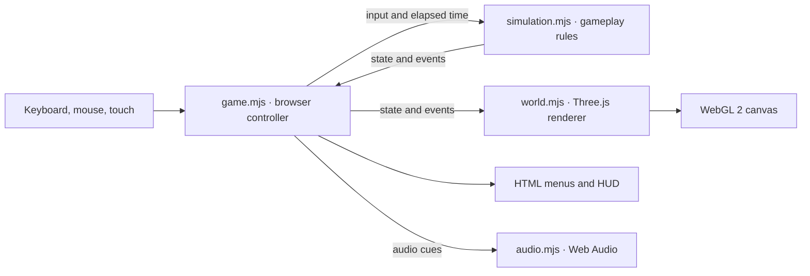

# Immune Protocol

A browser FPS about a nano-soldier injected into a patient. Fight five waves of viruses, bacilli, and spores in the Arterial Junction, and repair the tissue node to keep the host alive. Surviving the artery unlocks Capillary Junction, where pathogens attack from two branches. Clear both inlets to unlock Heart Valve, where the heartbeat determines when you can shoot and repair.

[Play on GitHub Pages](https://corycowgill.github.io/ImmuneProtocol/) · [Watch the demo](https://corycowgill.github.io/ImmuneProtocol/demo/)

## Run locally

You’ll need Node.js with npm, Python 3 on your `PATH` as `python`, and a browser that supports WebGL 2. From the repository root:

```sh
npm run dev
```

Open [http://127.0.0.1:8017](http://127.0.0.1:8017). The command serves `dist/` with Python’s static file server. Three.js and the game assets are included, so there’s no dependency install or build step. For a deployment, serve `dist/` from a static host. Run `npm run check` to check the game and intro scripts for JavaScript syntax errors. A recorded demo is available at [/demo/](http://127.0.0.1:8017/demo/) while the local server is running.

The Hallucinated Games studio intro plays before the main menu. Use Skip intro, press Escape, or open the game with `?nointro` to go straight to the menu.

Your first Arterial Junction deployment begins with one guided breach. Shoot the bacillus off the tissue, move into repair range, and hold Repair until the wound seals. The rest of Wave 1 starts after the seal. The browser remembers completed training for later deployments.

Choose **Start campaign** to play Arterial Junction, Capillary Junction, and Heart Valve in order. After the first two missions, equip **Fast Sealer** to restore 18 tissue points per pulse or **Deep Magazine** to carry 42 rounds before reloading. You can keep your pick or switch at the second checkpoint. A retry keeps the upgrade you brought into that mission. The final report shows tissue integrity for all three missions and the campaign totals for score and neutralized pathogens.

Returning to the main menu ends the current run. Unlocked practice missions are available from the menu with standard equipment.

## Publish updates

GitHub Pages serves the root of `gh-pages`. After committing game changes to `main`, publish the contents of `dist/` by running this command from `main`:

```sh
git subtree push --prefix=dist origin gh-pages
```

## Controls

| Action | Control |
| --- | --- |
| Move | WASD |
| Look | Mouse or arrow keys |
| Fire | Left click or Space |
| Aim | Hold right click |
| Sprint | Shift |
| Reload | R |
| Repair | Hold E next to the tissue node |
| Pause | Esc or P |

When mouse capture is unavailable, drag the view to look. On touchscreens, move with the joystick, drag to look, and use the action buttons.

Settings is available from the main menu and pause screen. Look sensitivity applies to mouse and touch aiming. Low graphics reduces rendering load on slower devices. Both settings are saved in the browser.

Viruses coil before lunging toward a fixed landing point. Spores swell before spitting a slow projectile. Step sideways during the windup to evade either attack. Bacilli head straight for the tissue, brace, and tear until you dislodge them.

Capillary Junction has three waves with different threats. Read the forecast during each break, then use **1**, **2**, or **3** to reinforce Amber, reinforce Teal, or take extra ammo. You can also select the options on screen. Reinforcing an inlet delays its attackers in the next wave.

In the breach wave, a bacillus tear can leave a gash that keeps draining tissue after the attacker dies. Move to the marked wound and hold Repair. Completed sealing pulses stay applied when you stop to fight or dodge. If a gash is still open after the last enemy falls, seal it to extract.

In Heart Valve, fire through the opening to hit the colony. Use each closed window to repair the wound. The mission ends when you destroy the colony and fully seal the valve tissue. Unlocks are saved in the browser.

The original soundtrack fades between **Arterial Drift** in the menu and between waves, and **Immune Response** during combat. It starts after you interact with the game. The speaker button mutes both the soundtrack and sound effects.

## Architecture

The game runs entirely in the browser. On each animation frame, the browser controller collects input and advances the simulation with the elapsed time, capped at 50 ms. The renderer reads the resulting state to move objects and draw effects. The controller also updates the HUD and plays audio cues from simulation events.



| File | Responsibility |
| --- | --- |
| [`dist/index.html`](dist/index.html), [`dist/styles.css`](dist/styles.css) | Menus, HUD, canvas, and touch controls. |
| [`dist/game.mjs`](dist/game.mjs) | Input, mouse capture, frame timing, and screen transitions. Browser storage remembers training completion, controls and graphics settings, mission unlocks, best score, and mute setting. |
| [`dist/simulation.mjs`](dist/simulation.mjs) | Movement, shooting, enemy targeting, wave progression, health, scoring, and tissue repair. It runs independently of the DOM and Three.js. |
| [`dist/world.mjs`](dist/world.mjs) | Arena geometry, lighting, atmosphere, enemies, and effects. The missions share the renderer and switch anatomy and lighting when the area changes. |
| [`dist/carbine.mjs`](dist/carbine.mjs) | The 3D carbine and armored gloves, including the articulated magazine, bolt, and hand poses. |
| [`dist/repair-tool.mjs`](dist/repair-tool.mjs) | The 3D tissue sealer that replaces the carbine while the player repairs the wound. |
| [`dist/heart-valve.mjs`](dist/heart-valve.mjs) | The moving valve and attached colony. The scene follows the same timing as the simulation's shot and repair windows. |
| [`dist/audio.mjs`](dist/audio.mjs) | Mixes original [sound effects](dist/assets/sfx) and two synchronized [soundtrack loops](dist/assets/music). Impacts and inlet activity pan with their position relative to the player. |

## How it was built

The artery is a real-time 3D scene. Code builds the vessel branches, membrane folds, drifting blood cells, and pathogens. The generated [tissue texture](dist/assets/tissue.webp) supplies surface color and is used to derive fine relief. Fog, wet material highlights, and particles give the chamber depth. Repeated geometry such as blood cells is instanced to keep the number of draw calls down.

The carbine and gloves are built from 3D meshes with physically based materials. The renderer draws the arena first, clears the depth buffer, and draws the weapon in a separately lit scene. This keeps the foreground model visible near walls while letting it sway, aim, recoil, and reload. The generated [title artwork](dist/assets/hero.webp) appears on the menu.

Tissue integrity controls how far the membrane splits open. As the player repairs it, the wound edges draw together while the sealing tool replaces the carbine in the foreground.

The effects use original samples made from layered transients, filtered noise, and short reflections. The mixer varies the carbine shots, syncs magazine sounds to the reload animation, and gives tissue hits and repair tools distinct textures over the arterial room tone.
