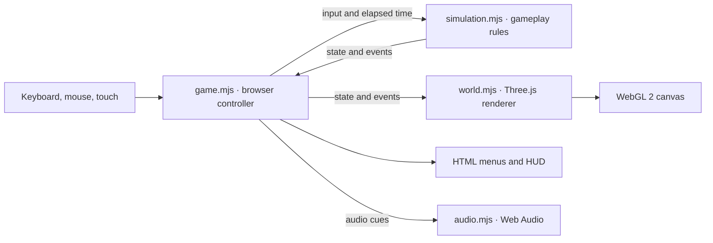

# Immune Protocol

A browser FPS about a nano-soldier injected into a patient. Defend two or three tissue nodes in each of ten missions. Place an auto-turret to cover one approach while you defend the others. The campaign starts in the bloodstream, then moves through the lungs, stomach, small intestine, colon, a lymph node, the inner ear, and the brain.

[Play on GitHub Pages](https://corycowgill.github.io/ImmuneProtocol/) · [Play online co-op](https://immune-protocol-coop.onrender.com/) · [Watch the demo](https://corycowgill.github.io/ImmuneProtocol/demo/)

## Run locally

You’ll need Node.js with npm, Python 3 on your `PATH` as `python`, and a browser that supports WebGL 2. From the repository root:

```sh
npm run dev
```

Open [http://127.0.0.1:8017](http://127.0.0.1:8017). The command serves `dist/` with Python’s static file server. Three.js and the game assets are included, so there’s no dependency install or build step. For a deployment, serve `dist/` from a static host. Run `npm run check` to check the game and intro scripts for JavaScript syntax errors. A recorded demo is available at [/demo/](http://127.0.0.1:8017/demo/) while the local server is running.

The Hallucinated Games studio intro plays before the main menu. Use Skip intro, press Escape, or open the game with `?nointro` to go straight to the menu.

Your first Arterial Junction deployment begins with one guided breach. Shoot the bacillus off the tissue, move into repair range, and hold Repair until the wound seals. The second node and turret become available as the rest of Wave 1 begins. The browser remembers completed training for later deployments.

Choose **Start campaign** to deploy into Arterial Junction. Between missions, equip one field upgrade. Your browser saves completed missions and the chosen upgrade at each checkpoint. **Continue campaign** shows the next mission and takes you back to its start. The final report shows the tissue preserved in all ten missions, total score, and pathogens neutralized.

| Field upgrade | Effect |
| --- | --- |
| Fast Sealer | Restores 18 tissue points per repair pulse. |
| Deep Magazine | Adds 12 rounds to the equipped magazine. |
| Insulated Suit | Reduces suit damage from stomach acid, intestinal pressure waves, and haustral squeezes by 40%. |
| Turret Stabilizer | Extends the turret's slow from 1.4 to 2.2 seconds. It still fires every 2.6 seconds. |

Open **Free Mode** to browse rendered previews of all ten arenas. Select a mission to read its briefing, choose a field upgrade, then select **Deploy**. Free Mode runs leave your campaign checkpoint, mission progression, and best score intact. Reaching the Mega Virus in Neural Cortex in either mode unlocks **Practice Mega Virus**, which starts directly at Wave 3 with fresh supplies.

The **Armory** lets you mix a barrel, muzzle, optic, receiver, and magazine. Each slot has three illustrated options. The armory compares each part against your equipped build and shows the combined weapon in 3D. Pick a body finish and an accent color independently. Your build is saved in the browser and works alongside your field upgrade.

The carbine has unlimited reserve ammunition. Magazine capacity and reload speed depend on your weapon build. The armory reopens between waves. First-time Arterial Junction training uses stock weapon stats until the guided breach is sealed.

The game prepares arena geometry, textures, audio, and armory previews before it enables deployment. The first load includes all ten arenas and the Mega Virus encounter.

## Online co-op

Two players share all ten missions in one room, from Arterial Junction to the Mega Virus fight in Neural Cortex. On the multiplayer server's game page, open **Online co-op**, enter a callsign, and choose **Create room**. Send the invite link to your friend. They open it, enter a callsign, and choose **Join room**. Choose **Ready** when both players are in the lobby.

After each mission, both players ready up at the shared checkpoint. A win unlocks the next deployment in the room, while a loss lets both players retry the current mission. Each deployment starts with fresh suits and supplies and keeps both weapon loadouts. The squad extracts after stabilizing Capillary Junction and earns a combined campaign report after the final boss. Campaign progress belongs to the active room.

In the lobby, each player picks a suit: **Vanguard** (heavy assault armor), **Wraith** (stealth infiltrator), **Lifeline** (field corpsman), or **Bathysphere** (deep-dive pressure suit). Both suits stand side by side in the lobby's deployment bay, and your teammate sees your suit during missions. Suits can be changed in the lobby or at a mission checkpoint, and the browser remembers your choice.

Each suit has its own carbine build, ammo, and health. You share the tissue nodes, one turret, the wave timer, and the mission score. If one suit goes down, it returns at the next wave if the teammate clears the current one. Both players can use the armory between waves and ready up to continue. The game holds your place for up to 75 seconds after a disconnect.

To test locally with two browser windows, run these commands from the repository root with Node 22 and npm. Open the resulting game at [http://127.0.0.1:8017](http://127.0.0.1:8017) and share its invite between the windows.

```sh
npm ci
npm run serve:coop
```

Run `npm run test:coop` to exercise the server with two WebSocket clients. The four suits are TRELLIS-generated 3D scans, processed by the Blender pipeline in `tools/trellis/` (Blender 4.2 LTS or newer, plus `npm i -g gltfpack`). `tools/trellis/run_pipeline.sh [suit ...]` runs every stage: download the source GLBs from their iCloud shares and validate them, identify which file is which suit, render untouched baselines, refine a master, render enhanced versions, then build, test, and report on the runtime GLBs.

- **Sources.** `download.py` resolves each iCloud share (`sources.json`), validates the GLB structure, and records the size and SHA-256 in `originals/manifest.json`. Originals are read-only and are only replaced with `--force` when the remote file changes.
- **Identification.** `identify.py` scores colour, texture, palette, and silhouette against `tools/suits/reference/` over all 24 assignments. It writes `mapping.json` only when the mapping is unambiguous.
- **Master.** `process.py master` keeps the scanned geometry. It only welds seam-split vertices, removes degenerate faces and tiny floaters, fixes winding, and smooth-shades by angle. It re-derives roughness and metallic per material class while keeping the source's own variation, and bakes ambient occlusion. Masters are saved to `masters/<suit>.blend`.
- **Runtime.** `process.py runtime` decimates a copy to about 45k triangles, re-unwraps it, and bakes 2K albedo, ORM, and normal maps from the master. It then lowers the T-posed arms at the shoulder and cuts the mesh into the 15 rigid joints of the game's teammate rig, with the suit's own joint pivots stored as glTF extras. The result is exported to `dist/assets/suits/<suit>.glb` and checked by `verify_export.py`.

Studio renders, QA images, and `reports/REPORT.md` cover each suit. In the game, a suit's GLB streams in the first time it's worn or shown in the lobby. Until then, or if loading fails, the game shows a primitive stand-in from `dist/suit-models.mjs` (`blender -b -P tools/suits/build_suits.py`) and logs that it's doing so. The server runs the shared simulation on a fixed tick, validates player input, and sends the result for each client to draw in Three.js.

### Host online co-op on Render

1. Open [Deploy Immune Protocol to Render](https://render.com/deploy?repo=https%3A%2F%2Fgithub.com%2Fcorycowgill%2FImmuneProtocol) and sign in. If asked to connect GitHub, grant Render access to the `ImmuneProtocol` repository.
2. Review the Blueprint and deploy the **immune-protocol-coop** web service. [render.yaml](render.yaml) specifies Node 22 through `package.json`, the Free plan in Ohio, branch `main`, and the build and startup commands.
3. Wait for the service to show **Live**, then open its `.onrender.com` game URL. Both players use that address. The `/healthz` endpoint responds when the game server is ready.

The Free service can take about a minute to wake after 15 minutes of inactivity. Rooms live in the running server's memory and expire on redeploy or restart. See [Render's Free plan documentation](https://render.com/docs/free).

## Campaign missions

Arenas are about twice the floor area they used to be, so tissue nodes sit 30 m or more apart and pathogens enter 20 m or more from the node they attack. Tissue organs, villus groves, biofilm mounds and crystal clusters block movement and give cover. When the last pathogen of a wave dies, a short countdown runs before the armory or mission report opens, so you can see the area clear.

| Mission | What to watch for |
| --- | --- |
| Arterial Junction | Learn to intercept attackers and repair the core before defending three nodes through five waves, under a river of red blood cells pumped through a beating valve. |
| Capillary Junction | Read the Amber and Teal attack forecasts, deploy support between waves, and choose whether to stay for Overtime. |
| Heart Valve | Shoot the colony through the open valve and defend the Septal Node against flank attacks. |
| Bronchial Fork | Survive three waves, reopen both bronchi, and keep them open through a full breath. |
| Gastric Chamber | Close the intake and drain the acid basin under fire, then defend the newly exposed lower passage. |
| Intestinal Bend | Defend three nodes in a swaying villus forest and move into the side channels to evade the pressure wave. |
| Colonic Reservoir | Hold three nodes in the microbiome while haustral squeezes sweep the chamber from side to side. |
| Lymph Node | A patrolling macrophage digests every pathogen it touches, and crushes suits. Lure infections into its path while you hold three nodes. |
| Inner Ear | Place your turret outside the resonance zones to keep it firing. Resonance rotates between three nodes. |
| Neural Cortex | Survive two waves, then fight the Mega Virus as its connected bodies take turns exposing their cores. |

## Publish updates

GitHub Pages serves the root of `gh-pages`. After committing game changes to `main`, publish the contents of `dist/` by running this command from `main`:

```sh
git subtree push --prefix=dist origin gh-pages
```

## Controls

| Action | Keyboard and mouse | Xbox controller |
| --- | --- | --- |
| Move | WASD | Left stick |
| Look | Mouse or arrow keys | Right stick |
| Fire | Left click or Space | Hold RT |
| Aim | Hold right click | Hold LT |
| Sprint | Shift | Click the left stick |
| Reload | R | X |
| Repair | Hold E near a damaged tissue node or open gash | Hold LB |
| Deploy or redeploy auto-turret | Q | RB |
| Pause | Esc or P | Menu ☰ |

When mouse capture is unavailable, drag the view to look. On touchscreens, move with the joystick, drag to look, and use the action buttons.

Connect an Xbox controller to your device and press a button with the game tab focused. Use the D-pad or left stick to navigate menus, **A** to select, and **B** to go back. In Capillary Junction, the D-pad chooses support during the wave break. Left reinforces Amber, right reinforces Teal, up selects Load magazines, and down selects turret redeployment. If your browser gates audio, click the game or press a keyboard key once to enable it. Enter co-op callsigns and room codes with your keyboard.

Each node has its own integrity meter and direction marker. Losing any node ends the mission. You can deploy one turret per mission on clear ground ahead of you. It stays where you place it and fires one shot every 2.6 seconds at targets within about 12 meters. Hits damage and briefly slow pathogens. Put it near an approach to the node you plan to leave.

Settings is available from the main menu and pause screen. Look sensitivity applies to mouse, touch, and the Xbox right stick. Low graphics reduces rendering load on slower devices. Both settings are saved in the browser.

Viruses coil before lunging toward a fixed landing point. Spores swell before spitting a slow projectile. Step sideways during the windup to evade either attack. Bacilli head straight for the tissue, brace, and tear until you dislodge them.

Shellbacks guard their front. Aim for exposed tissue from the side or rear. Splitters break into two smaller attackers on death, so keep the area in sight after the first kill.

Capillary Junction has three waves with staggered attacks. The HUD names the next targeted node, the incoming pathogen, and the time until it enters. In Wave 3, an Amber virus rush arrives six seconds before the Teal bacillus breach.

During each break, use **1** to reinforce Amber, **2** to reinforce Teal, **3** to start the next wave with a full magazine, or **4** to redeploy a turret you've already placed. You can also select the options on screen. Reinforcement starts when the first attacker enters the chosen inlet. After choosing redeploy, face clear ground and press **Q** or tap **Turret** before the next wave. A successful move uses your support choice for that break. The turret keeps its position until you find a valid new spot.

In the breach wave, a bacillus tear can leave a gash that keeps draining tissue after the attacker dies. Move to the marked wound and hold Repair. Completed sealing pulses stay applied when you stop to fight or dodge. If a gash is still open after the last enemy falls, seal it to extract.

After securing Capillary Junction, choose **Extract** to bank the result or **Stay for overtime**. Both nodes, your remaining suit health and ammo, and your turret carry into overtime. Stop the Teal breach, clear the Amber spore pressure, and seal any gash to earn 2,000 bonus points. If you lose in overtime, retry Capillary Junction from Wave 1.

In Heart Valve, fire through the opening to hit the colony. Use each closed window to repair the valve wound. The outer wall can be repaired at any time. The mission ends when the colony and flank threats are gone and both nodes are restored. Unlocks are saved in the browser.

In **Bronchial Fork**, move to each blocked bronchus after the third wave and hold Repair to reopen it. Completed pulses carry over while you stop to fight. Once both bronchi are open, keep both tissue nodes at **45% integrity or higher** through one full breath. If integrity drops below 45%, that side clogs again. Watch the exhale timer when crossing the central airway, and clear any surviving pathogens before leaving.

In **Gastric Chamber**, clear the first wave, then hold Repair at the intake on the west bank. Closing it diverts acid into the drain channel. Cross to the east bank and hold Repair at the drain valve. Completed pulses carry over if you stop to fight. Once the basin empties, watch the lower passage behind the insertion point. The final wave uses it to flank both tissue nodes.

The **Mega Virus** is Neural Cortex's third wave. Its connected membranes protect three cores. Follow the pulse to the core about to open, then shoot the exposed tissue. When the shell closes, clear spawned viruses, reload, and repair. Neural overload blocks repairs at the highlighted node during exposure. In the final phase, Shellbacks and Splitters pressure opposite sides. Clear any survivors after the boss falls.

The original soundtrack fades between **Arterial Drift** in the menu and between waves, and **Immune Response** during combat. It starts after you interact with the game. The speaker button mutes both the soundtrack and sound effects.

## Architecture

Solo missions run in the browser. The controller collects input, advances the simulation on each frame, then uses the resulting state to draw the arena, update the HUD, and play audio. During online co-op, the controller sends input to the Node server, which runs the authoritative simulation at 30 ticks per second. The browser predicts local movement and interpolates state updates for other actors.



| File | Responsibility |
| --- | --- |
| [`dist/index.html`](dist/index.html), [`dist/styles.css`](dist/styles.css) | Menus, HUD, canvas, and touch controls. |
| [`dist/game.mjs`](dist/game.mjs) | Input, mouse capture, frame timing, and screen transitions. Browser storage remembers campaign checkpoints, mission unlocks, best score, training completion, and player settings. |
| [`dist/simulation.mjs`](dist/simulation.mjs) | Movement, shooting, lane and node targeting, turret behavior, wave progression, scoring, and repair. It runs independently of the DOM and Three.js. |
| [`dist/coop-simulation.mjs`](dist/coop-simulation.mjs) | Per-suit state and shared wave rules for two players. |
| [`server/rooms.mjs`](server/rooms.mjs), [`dist/coop-client.mjs`](dist/coop-client.mjs) | Match rooms, WebSocket transport, reconnects, and client-side prediction. |
| [`dist/world.mjs`](dist/world.mjs) | Arena geometry, lighting, atmosphere, enemies, and effects. The missions share the renderer and switch anatomy and lighting when the area changes. |
| [`dist/organs.mjs`](dist/organs.mjs) | Mission data for the seven organ missions, including node coordinates, spawn inlets, solid obstacles, wave compositions, and hazard timings. |
| [`dist/organ-world.mjs`](dist/organ-world.mjs) | Procedural anatomy, organ-specific materials, and animated hazard geometry. |
| [`dist/level-props.mjs`](dist/level-props.mjs) | Set dressing and ambient VFX: red-blood-cell rivers and a pumping valve gate, neutrophil patrols that engulf bacteria, the villus forest, the colon microbiome, the lymph-node macrophage, the firing neural web, obstacle props, and light shafts. |
| [`dist/bio-textures.mjs`](dist/bio-textures.mjs) | Tileable red cell, mucosa, biofilm, neural, and leukocyte surface maps generated at load time. |
| [`dist/level-hud.mjs`](dist/level-hud.mjs) | The third node readout and marker, the wave-clear countdown banner, and Free Mode cards whose previews are rendered while the arenas load. |
| [`dist/brain-boss.mjs`](dist/brain-boss.mjs), [`dist/mega-virus.mjs`](dist/mega-virus.mjs) | The finale's phase rules, physical shot gates, and connected 3D creature. |
| [`dist/carbine.mjs`](dist/carbine.mjs) | The 3D carbine and armored gloves, including modular parts, finishes, and articulated reload poses. |
| [`dist/weapon-mods.mjs`](dist/weapon-mods.mjs), [`dist/armory-art.mjs`](dist/armory-art.mjs) | Attachment stats, saved build validation, and armory images rendered from the same 3D parts used in combat. |
| [`dist/repair-tool.mjs`](dist/repair-tool.mjs) | The 3D tissue sealer that replaces the carbine while the player repairs the wound. |
| [`dist/heart-valve.mjs`](dist/heart-valve.mjs) | The moving valve and attached colony. The scene follows the same timing as the simulation's shot and repair windows. |
| [`dist/turret.mjs`](dist/turret.mjs) | The 3D auto-turret with its aiming mount, deployment animation, and recoil. |
| [`dist/audio.mjs`](dist/audio.mjs) | Mixes original [sound effects](dist/assets/sfx) and two synchronized [soundtrack loops](dist/assets/music). Impacts and inlet activity pan with their position relative to the player. |

## How it was built

The artery is a real-time 3D scene. Code builds the vessel branches, membrane folds, drifting blood cells, and pathogens. The generated [tissue texture](dist/assets/tissue.webp) supplies surface color and is used to derive fine relief. Fog, wet material highlights, and particles give the chamber depth. Repeated geometry such as blood cells is instanced to keep the number of draw calls down.

The carbine and gloves are built from 3D meshes with physically based materials. The renderer draws the arena first, clears the depth buffer, and draws the weapon in a separately lit scene. This keeps the foreground model visible near walls while letting it sway, aim, recoil, and reload. The generated [title artwork](dist/assets/hero.webp) appears on the menu.

Each node's integrity controls how far its membrane splits open. As the player repairs a node, its wound edges draw together while the sealing tool replaces the carbine in the foreground.

The effects use original samples made from layered transients, filtered noise, and short reflections. The mixer varies the carbine shots, syncs magazine sounds to the reload animation, and gives tissue hits and repair tools distinct textures over the arterial room tone.
