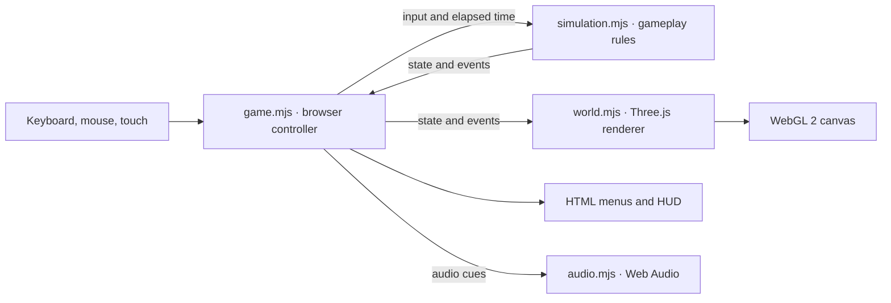

# Immune Protocol

A browser FPS about a nano-soldier injected into a patient. Defend two tissue nodes in each of eight missions. Place an auto-turret to cover one approach while you defend the other. The campaign starts in the bloodstream, then moves through the lungs, stomach, intestines, inner ear, and brain.

[Play on GitHub Pages](https://corycowgill.github.io/ImmuneProtocol/) · [Watch the demo](https://corycowgill.github.io/ImmuneProtocol/demo/)

## Run locally

You’ll need Node.js with npm, Python 3 on your `PATH` as `python`, and a browser that supports WebGL 2. From the repository root:

```sh
npm run dev
```

Open [http://127.0.0.1:8017](http://127.0.0.1:8017). The command serves `dist/` with Python’s static file server. Three.js and the game assets are included, so there’s no dependency install or build step. For a deployment, serve `dist/` from a static host. Run `npm run check` to check the game and intro scripts for JavaScript syntax errors. A recorded demo is available at [/demo/](http://127.0.0.1:8017/demo/) while the local server is running.

The Hallucinated Games studio intro plays before the main menu. Use Skip intro, press Escape, or open the game with `?nointro` to go straight to the menu.

Your first Arterial Junction deployment begins with one guided breach. Shoot the bacillus off the tissue, move into repair range, and hold Repair until the wound seals. The second node and turret become available as the rest of Wave 1 begins. The browser remembers completed training for later deployments.

Choose **Start campaign** to deploy into Arterial Junction. Between missions, equip **Fast Sealer** to restore 18 tissue points per pulse or **Deep Magazine** to carry 42 rounds before reloading. Your browser saves completed missions and the chosen upgrade at each checkpoint. Use **Resume** to return to the start of the current mission. The final report shows the tissue preserved in all eight missions, total score, and pathogens neutralized. Open **Mission select** to replay unlocked areas with standard equipment.

## Campaign missions

| Mission | What to watch for |
| --- | --- |
| Arterial Junction | Learn to intercept attackers and repair the core before defending both nodes through five waves. |
| Capillary Junction | Read the Amber and Teal attack forecasts, deploy support between waves, and choose whether to stay for Overtime. |
| Heart Valve | Shoot the colony through the open valve and defend the Septal Node against flank attacks. |
| Bronchial Fork | Step out of the central airway before each exhale pushes through it. |
| Gastric Chamber | Fight from the sides when acid floods the central basin. |
| Intestinal Bend | Move into the side channels to evade the pressure wave. |
| Inner Ear | Place your turret outside the resonance zones to keep it firing. |
| Neural Cortex | Rotate between nodes as neural overload temporarily blocks repairs and amplifies attacks. |

## Publish updates

GitHub Pages serves the root of `gh-pages`. After committing game changes to `main`, publish the contents of `dist/` by running this command from `main`:

```sh
git subtree push --prefix=dist origin gh-pages
```

## Controls

| Action | Control |
| --- | --- |
| Move | WASD |
| Look | Mouse or arrow keys |
| Fire | Left click or Space |
| Aim | Hold right click |
| Sprint | Shift |
| Reload | R |
| Repair | Hold E near a damaged tissue node or open gash |
| Deploy or redeploy auto-turret | Q |
| Pause | Esc or P |

When mouse capture is unavailable, drag the view to look. On touchscreens, move with the joystick, drag to look, and use the action buttons.

Each node has its own integrity meter and direction marker. Losing either node ends the mission. You can deploy one turret per mission on clear ground ahead of you. It stays where you place it and fires one shot every 2.6 seconds at targets within about 10 meters. Hits damage and briefly slow pathogens. Put it near an approach to the node you plan to leave.

Settings is available from the main menu and pause screen. Look sensitivity applies to mouse and touch aiming. Low graphics reduces rendering load on slower devices. Both settings are saved in the browser.

Viruses coil before lunging toward a fixed landing point. Spores swell before spitting a slow projectile. Step sideways during the windup to evade either attack. Bacilli head straight for the tissue, brace, and tear until you dislodge them.

Shellbacks guard their front. Aim for exposed tissue from the side or rear. Splitters break into two smaller attackers on death, so keep the area in sight after the first kill.

Capillary Junction has three waves with staggered attacks. The HUD names the next targeted node, the incoming pathogen, and the time until it enters. In Wave 3, an Amber virus rush arrives six seconds before the Teal bacillus breach.

During each break, use **1** to reinforce Amber, **2** to reinforce Teal, **3** for extra ammo, or **4** to redeploy a turret you've already placed. You can also select the options on screen. Reinforcement starts when the first attacker enters the chosen inlet. After choosing redeploy, face clear ground and press **Q** or tap **Turret** before the next wave. A successful move uses your support choice for that break. The turret keeps its position until you find a valid new spot.

In the breach wave, a bacillus tear can leave a gash that keeps draining tissue after the attacker dies. Move to the marked wound and hold Repair. Completed sealing pulses stay applied when you stop to fight or dodge. If a gash is still open after the last enemy falls, seal it to extract.

After securing Capillary Junction, choose **Extract** to bank the result or **Stay for overtime**. Both nodes, your remaining suit health and ammo, and your turret carry into overtime. Stop the Teal breach, clear the Amber spore pressure, and seal any gash to earn 2,000 bonus points. If you lose in overtime, retry Capillary Junction from Wave 1.

In Heart Valve, fire through the opening to hit the colony. Use each closed window to repair the valve wound. The outer wall can be repaired at any time. The mission ends when the colony and flank threats are gone and both nodes are restored. Unlocks are saved in the browser.

The original soundtrack fades between **Arterial Drift** in the menu and between waves, and **Immune Response** during combat. It starts after you interact with the game. The speaker button mutes both the soundtrack and sound effects.

## Architecture

The game runs entirely in the browser. On each animation frame, the browser controller collects input and advances the simulation with the elapsed time, capped at 50 ms. The renderer reads the resulting state to move objects and draw effects. The controller also updates the HUD and plays audio cues from simulation events.



| File | Responsibility |
| --- | --- |
| [`dist/index.html`](dist/index.html), [`dist/styles.css`](dist/styles.css) | Menus, HUD, canvas, and touch controls. |
| [`dist/game.mjs`](dist/game.mjs) | Input, mouse capture, frame timing, and screen transitions. Browser storage remembers campaign checkpoints, mission unlocks, best score, training completion, and player settings. |
| [`dist/simulation.mjs`](dist/simulation.mjs) | Movement, shooting, lane and node targeting, turret behavior, wave progression, scoring, and repair. It runs independently of the DOM and Three.js. |
| [`dist/world.mjs`](dist/world.mjs) | Arena geometry, lighting, atmosphere, enemies, and effects. The missions share the renderer and switch anatomy and lighting when the area changes. |
| [`dist/organs.mjs`](dist/organs.mjs) | Mission data for the five new organs, including node coordinates, wave compositions, and hazard timings. |
| [`dist/organ-world.mjs`](dist/organ-world.mjs) | Procedural anatomy, organ-specific materials, and animated hazard geometry. |
| [`dist/carbine.mjs`](dist/carbine.mjs) | The 3D carbine and armored gloves, including the articulated magazine, bolt, and hand poses. |
| [`dist/repair-tool.mjs`](dist/repair-tool.mjs) | The 3D tissue sealer that replaces the carbine while the player repairs the wound. |
| [`dist/heart-valve.mjs`](dist/heart-valve.mjs) | The moving valve and attached colony. The scene follows the same timing as the simulation's shot and repair windows. |
| [`dist/turret.mjs`](dist/turret.mjs) | The 3D auto-turret with its aiming mount, deployment animation, and recoil. |
| [`dist/audio.mjs`](dist/audio.mjs) | Mixes original [sound effects](dist/assets/sfx) and two synchronized [soundtrack loops](dist/assets/music). Impacts and inlet activity pan with their position relative to the player. |

## How it was built

The artery is a real-time 3D scene. Code builds the vessel branches, membrane folds, drifting blood cells, and pathogens. The generated [tissue texture](dist/assets/tissue.webp) supplies surface color and is used to derive fine relief. Fog, wet material highlights, and particles give the chamber depth. Repeated geometry such as blood cells is instanced to keep the number of draw calls down.

The carbine and gloves are built from 3D meshes with physically based materials. The renderer draws the arena first, clears the depth buffer, and draws the weapon in a separately lit scene. This keeps the foreground model visible near walls while letting it sway, aim, recoil, and reload. The generated [title artwork](dist/assets/hero.webp) appears on the menu.

Each node's integrity controls how far its membrane splits open. As the player repairs a node, its wound edges draw together while the sealing tool replaces the carbine in the foreground.

The effects use original samples made from layered transients, filtered noise, and short reflections. The mixer varies the carbine shots, syncs magazine sounds to the reload animation, and gives tissue hits and repair tools distinct textures over the arterial room tone.
