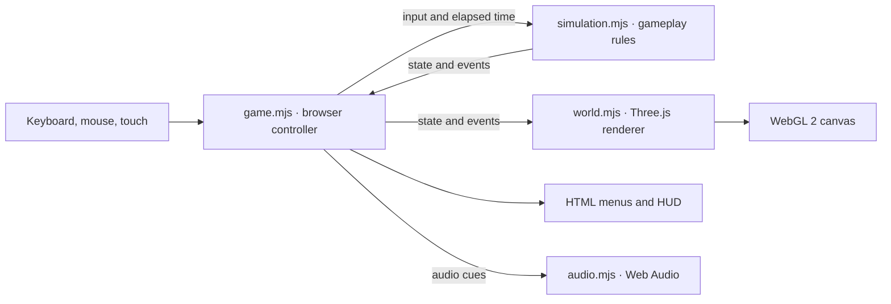

# Immune Protocol

A browser FPS about a nano-soldier injected into a patient. Fight five waves of viruses, bacilli, and spores in the Arterial Junction, and repair the tissue node to keep the host alive. Surviving the artery unlocks the Capillary Junction, where pathogens attack from two branches.

[Play on GitHub Pages](https://corycowgill.github.io/ImmuneProtocol/) · [Watch the demo](https://corycowgill.github.io/ImmuneProtocol/demo/)

## Run locally

You’ll need Node.js with npm, Python 3 on your `PATH` as `python`, and a browser that supports WebGL 2. From the repository root:

```sh
npm run dev
```

Open [http://127.0.0.1:8017](http://127.0.0.1:8017). The command serves `dist/` with Python’s static file server. Three.js and the game assets are included, so there’s no dependency install or build step. For a deployment, serve `dist/` from a static host. Run `npm run check` to check the game and intro scripts for JavaScript syntax errors. A recorded demo is available at [/demo/](http://127.0.0.1:8017/demo/) while the local server is running.

The Hallucinated Games studio intro plays before the main menu. Use Skip intro, press Escape, or open the game with `?nointro` to go straight to the menu.

## Publish updates

GitHub Pages serves the root of `gh-pages`. After committing game changes to `main`, publish the contents of `dist/` by running this command from `main`:

```sh
git subtree push --prefix=dist origin gh-pages
```

## Controls

| Action | Control |
| --- | --- |
| Move | WASD |
| Look | Mouse or arrow keys |
| Fire | Left click or Space |
| Aim | Hold right click |
| Sprint | Shift |
| Reload | R |
| Repair | Hold E next to the tissue node |
| Pause | Esc or P |

When mouse capture is unavailable, drag the view to look. On touchscreens, move with the joystick, drag to look, and use the action buttons.

## Architecture

The game runs entirely in the browser. On each animation frame, the browser controller collects input and advances the simulation with the elapsed time, capped at 50 ms. The renderer reads the resulting state to move objects and draw effects. The controller also updates the HUD and plays audio cues from simulation events.



| File | Responsibility |
| --- | --- |
| [`dist/index.html`](dist/index.html), [`dist/styles.css`](dist/styles.css) | Menus, HUD, canvas, and touch controls. |
| [`dist/game.mjs`](dist/game.mjs) | Input, mouse capture, frame timing, and screen transitions. Browser storage remembers the Junction unlock, best score, and mute setting. |
| [`dist/simulation.mjs`](dist/simulation.mjs) | Movement, shooting, enemy targeting, wave progression, health, scoring, and tissue repair. It runs independently of the DOM and Three.js. |
| [`dist/world.mjs`](dist/world.mjs) | Arena geometry, lighting, atmosphere, enemies, and effects. Both missions share the renderer and switch anatomy and lighting when the area changes. |
| [`dist/carbine.mjs`](dist/carbine.mjs) | The 3D carbine and armored gloves, including the articulated magazine, bolt, and hand poses. |
| [`dist/audio.mjs`](dist/audio.mjs) | Synthesized weapon, pathogen, and repair sounds. Junction cues pan toward the active branch relative to the player’s view. |

## How it was built

The artery is a real-time 3D scene. Code builds the vessel branches, membrane folds, drifting blood cells, and pathogens. The generated [tissue texture](dist/assets/tissue.webp) supplies surface color and is used to derive fine relief. Fog, wet material highlights, and particles give the chamber depth. Repeated geometry such as blood cells is instanced to keep the number of draw calls down.

The carbine and gloves are built from 3D meshes with physically based materials. The renderer draws the arena first, clears the depth buffer, and draws the weapon in a separately lit scene. This keeps the foreground model visible near walls while letting it sway, aim, recoil, and reload. The generated [title artwork](dist/assets/hero.webp) appears on the menu.
