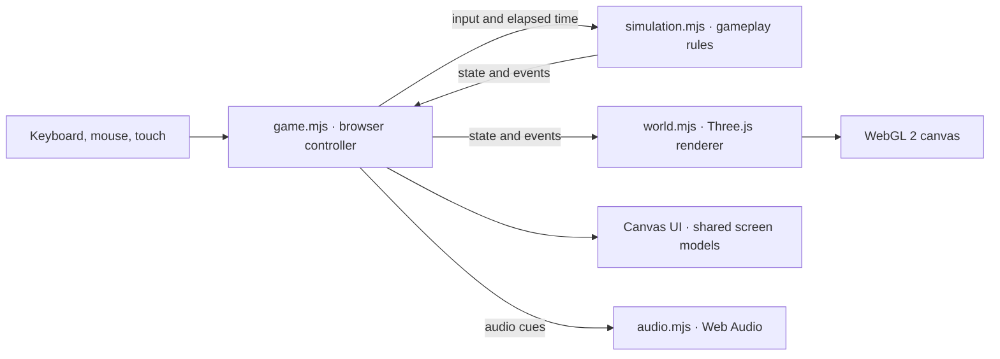

# Immune Protocol development guide

How to run, test, profile, publish and extend the game, and how its assets are built. For how the game plays, see the [player guide](player-guide.md).

- [Run locally](#run-locally)
- [Tests, checks and benchmarks](#tests-checks-and-benchmarks)
- [Debug and profiling pages](#debug-and-profiling-pages)
- [Architecture](#architecture)
- [Gameplay systems](#gameplay-systems)
- [Online co-op server](#online-co-op-server)
- [Saves and operator profiles](#saves-and-operator-profiles)
- [Loading, memory and performance](#loading-memory-and-performance)
- [Rendering and arena dressing](#rendering-and-arena-dressing)
- [Asset pipelines](#asset-pipelines)
- [Localization](#localization)
- [Publish updates](#publish-updates)
- [How it was built](#how-it-was-built)
- [Further docs](#further-docs)

## Run locally

You'll need Node.js with npm, Python 3 on your `PATH` as `python`, and a browser that supports WebGL 2. From the repository root:

```sh
npm run dev
```

Open [http://127.0.0.1:8017](http://127.0.0.1:8017). The command serves `dist/` with Python's static file server. Three.js and the game assets are included, so there's no dependency install or build step. For a deployment, serve `dist/` from a static host. A recorded demo is available at [/demo/](http://127.0.0.1:8017/demo/) while the local server is running. Open the game with `?nointro` to skip the studio intro.

To run the co-op server instead, see [Online co-op server](#online-co-op-server).

## Tests, checks and benchmarks

| Command | What it does |
| --- | --- |
| `npm run check` | Checks the game, intro, server and tool scripts for JavaScript syntax errors. |
| `npm test` | Runs every `server/*.test.mjs` suite. |
| `npm run test:coop` | Exercises the server with two- and three-player WebSocket clients, plus checkpoints, bosses, field objectives, suits, enemies and weapons. It also checks that every species has a model, animation targets, a portrait, a guide entry and at least one mission. |
| `npm run test:ai` | Deterministic tactical AI behavior tests. |
| `npm run benchmark:ai` | Ten-arena CPU benchmark for the tactical AI. |
| `npm run test:encounters` / `npm run benchmark:encounters` | Encounter pattern regressions and benchmark. |
| `npm run test:bosses` / `npm run benchmark:bosses` | Boss regressions and benchmark. |
| `npm run test:rogue-bot` | Rogue Bot checks. `node --test server/crawler.test.mjs` runs the Crawler's. |
| `npm run test:achievements` | Achievement rules against the real simulation. |
| `npm run test:companions` | Companion choice, per-suit turrets, drone following, stationing and mending, co-op snapshots and checkpoints. |
| `npm run test:endless` | Endless wave growth, boss waves, scaling, the field cap and saved records. |
| `node --test server/profiles.test.mjs` | Operator profile migration, isolation, naming, deletion and recovery. |
| `npm run test:render` | Resource reuse, reset and render-scale regression tests. |
| `npm run balance` | Plays every mission headlessly with two scripted strategies on each difficulty (see below). |
| `npm run verify:loading` | Serves a browser report that exercises every arena and weapon (see [Loading](#loading-memory-and-performance)). |

`npm run balance -- --companion drone` plays with the medic drone instead of the turret (the bot never stations it). For experiments without editing the game, `BALANCE_REPAIR=11` sets the sealer's tissue per pulse and `BALANCE_DRONE=1,1` the drone's suit and tissue mending per second. The bot also reports how many of its losses were to its suit failing.

`npm run balance` uses two strategies. Both play the way a careful player would: they take cover from organ hazards once warned (onto raised ground high enough to clear acid, contractions and squeezes, or out of the exhale and resonance zones), sidestep boss charges and back out of telegraphed slams, shoot the Rogue Macrophage to break its pull, bash a Grip Phage off, and walk round a tissue node to reach a pathogen hidden behind it. Without that, the bot used to lose most organ missions to hazards it never dodged. `BALANCE_WHY=1` adds a breakdown of where each mission's suit and tissue damage came from. The measured curve behind the per-mission tuning in `difficulty.mjs` is in [`tools/performance/difficulty-curve.txt`](../tools/performance/difficulty-curve.txt). The anchor guards the weakest node. The rover runs to the node under the most pressure and switches targets when Shellbacks block its shots. The script prints win rates and the lowest tissue integrity per run, and exits with an error if a mission is never won on some difficulty. Narrow it with `npm run balance -- --difficulty hard --trials 20 stomach colon`. The bot is [`tools/balance/balance-bot.mjs`](../tools/balance/balance-bot.mjs).

## Debug and profiling pages

`npm run profile` starts the local performance server and prints its address (by default `http://127.0.0.1:8027`). These pages are served only by that server:

| Page | Shows |
| --- | --- |
| `/__profile` | Per-arena draw calls, triangles and CPU time. |
| `/__overview` | A top-down plan of every arena with its nodes, inlets, obstacles and hazard zone. |
| `/__bosses` | Each boss fight for inspection. |
| `/__deaths` | Each pathogen death animation on demand. |
| `/__hazards?area=stomach&noweapon` | Any arena's hazard in its warning or active state. |
| `/__look?area=artery` | One arena at High quality on demand, for before-and-after captures. |
| `/__hud` | The real HUD and renderer with selectable combat, boss, hazard, training and objective states. |
| `/__mobile?memory=low` | The mobile loading path on a desktop (via `npm run verify:loading`). This override is ignored on public hosts. |

Check the HUD at 852×393 and 667×375 landscape, 393×852 portrait, and 1280×720 desktop. Touch targets should remain at least 44×44 CSS pixels.

In game, press **F3** during play for the AI decision and telemetry overlay; **Shift+F3** cycles visual layers. On `localhost`, `window.__achievements` exposes the achievement tracker and toast queue for testing (for example `__achievements.achievements.unlock('fever-pitch')`).

## Architecture

Solo missions run in the browser. The controller collects input, advances the simulation on each frame, then uses the resulting state to draw the arena, update the HUD, and play audio. During online co-op, the controller sends input to the Node server, which runs the authoritative simulation at 30 ticks per second. The browser predicts local movement and interpolates state updates for other actors.



| File | Responsibility |
| --- | --- |
| [`dist/index.html`](../dist/index.html), [`dist/styles.css`](../dist/styles.css) | Browser shell and nonvisual compatibility controls for the existing screen controllers. |
| [`dist/game.mjs`](../dist/game.mjs) | The game loop and screen flow: startup, deploying and retrying missions, pause, the mission report, the campaign, Free Mode, settings and the co-op lobby. |
| [`dist/session.mjs`](../dist/session.mjs) | The live state the modules below share (the world, the running mission, pause and co-op flags, HUD feedback timers). An imported variable is read-only, so anything one module changes and another reads lives here. |
| [`dist/hud.mjs`](../dist/hud.mjs), [`dist/field-events.mjs`](../dist/field-events.mjs) | Updating combat HUD values and world-projected markers for the UI adapter; reacting to each step with sounds, announcements and hit feedback. |
| [`dist/ui-core.mjs`](../dist/ui-core.mjs), [`dist/ui-screens.mjs`](../dist/ui-screens.mjs), [`dist/ui-renderer.mjs`](../dist/ui-renderer.mjs) | Portable UI layout/input, plain screen definitions and canvas drawing. |
| [`dist/ui-browser.mjs`](../dist/ui-browser.mjs), [`dist/ui-bindings.mjs`](../dist/ui-bindings.mjs) | Browser host, accessibility and text entry, plus the compatibility adapter for existing screen controllers. |
| [`dist/controls.mjs`](../dist/controls.mjs) | Keyboard, mouse with pointer lock, touch controls and gamepads. Listeners record held and tapped input in `controls` for the game loop. |
| [`dist/armory-menu.mjs`](../dist/armory-menu.mjs), [`dist/armory-screen.mjs`](../dist/armory-screen.mjs) | Opening the armory, the turning weapon on the bench, and its Weapons, Gunsmith and Customize tabs. |
| [`dist/dom.mjs`](../dist/dom.mjs), [`dist/settings-store.mjs`](../dist/settings-store.mjs), [`dist/mission-text.mjs`](../dist/mission-text.mjs) | DOM helpers; settings and progress saved in the browser (campaign checkpoint, unlocks, best score, training, settings), with progress kept under the active operator profile; mission names and campaign order. |
| [`dist/simulation.mjs`](../dist/simulation.mjs) | Movement, shooting, lane and node targeting, turret behavior, wave progression, scoring, and repair. It runs independently of the DOM and Three.js. |
| [`dist/tactical-ai.mjs`](../dist/tactical-ai.mjs), [`dist/ai-profiles.mjs`](../dist/ai-profiles.mjs), [`dist/ai-navigation.mjs`](../dist/ai-navigation.mjs), [`dist/ai-debug.mjs`](../dist/ai-debug.mjs) | Pathogen tactical AI: sensing and memory, per-species profiles, obstacle-aware routes, the pressure director, and the F3 debug overlay. See [tactical-ai.md](tactical-ai.md). |
| [`dist/encounters.mjs`](../dist/encounters.mjs), [`dist/encounter-ui.mjs`](../dist/encounter-ui.mjs) | Encounter patterns and pacing for ordinary waves. See [encounters.md](encounters.md). |
| [`dist/level-bosses.mjs`](../dist/level-bosses.mjs), [`dist/boss-tactics.mjs`](../dist/boss-tactics.mjs), [`dist/boss-telegraphs.mjs`](../dist/boss-telegraphs.mjs) | Boss logic, tactics and windups. See [boss-battles.md](boss-battles.md). |
| [`dist/field-objectives.mjs`](../dist/field-objectives.mjs) | Brood nests and antibody caches. |
| [`dist/endless.mjs`](../dist/endless.mjs) | Endless mode: generated waves, per-wave scaling, boss waves, the field cap and saved records. |
| [`dist/terrain.mjs`](../dist/terrain.mjs), [`dist/terrain-view.mjs`](../dist/terrain-view.mjs) | Raised ground in every arena and how it is drawn. |
| [`dist/coop-simulation.mjs`](../dist/coop-simulation.mjs) | Per-suit state and shared wave rules for two or three players. |
| [`server/rooms.mjs`](../server/rooms.mjs), [`dist/coop-client.mjs`](../dist/coop-client.mjs) | Match rooms, WebSocket transport, reconnects, and client-side prediction. |
| [`dist/world.mjs`](../dist/world.mjs) | The renderer and scene: switching arenas and lighting, quality, and drawing each frame. The missions share one renderer. |
| [`dist/arena-scene.mjs`](../dist/arena-scene.mjs), [`dist/arena-textures.mjs`](../dist/arena-textures.mjs) | The shared arena (floor, walls, vessels, atmosphere, the junction and heart chambers, tissue nodes and wounds) and its procedural textures. |
| [`dist/ground-fx.mjs`](../dist/ground-fx.mjs) | Each arena's unique painted ground (colour, contact shadow, tissue blend, wetness and vessel maps) and the floor shader that uses them: anti-tiled sampling, a height-blended second tissue, varying relief, wet gloss, close-range detail and the caustics. |
| [`dist/post-fx.mjs`](../dist/post-fx.mjs), [`dist/surface-fx.mjs`](../dist/surface-fx.mjs) | The High-quality finishing pipeline and wet-tissue surfaces: HDR rendering, ambient occlusion and drifting ground mist from the depth buffer, mip-chain bloom, ACES tone mapping, a colour grade per arena, vignette, a faint lens fringe and film grain; animated caustics on every floor and a translucent rim glow on walls and canopy. |
| [`dist/world-preparation.mjs`](../dist/world-preparation.mjs) | Startup and per-deployment preparation: downloads, texture uploads, shader compiles and rehearsed frames, so nothing stalls once a mission starts. |
| [`dist/pathogen-views.mjs`](../dist/pathogen-views.mjs), [`dist/weapon-view.mjs`](../dist/weapon-view.mjs) | Posing every pathogen, nest and boss from the simulation; and the first-person weapon, repair tool, shots and tracers. |
| [`dist/shot-fx.mjs`](../dist/shot-fx.mjs) | The layered muzzle flash, travelling tracer ribbons and the holographic reticle in reflex and red-dot sights. |
| [`dist/impact-fx.mjs`](../dist/impact-fx.mjs), [`dist/death-fx.mjs`](../dist/death-fx.mjs) | Bullet holes, hit sprays and scorch marks; per-species death animations with pooled debris and puddles. |
| [`dist/organs.mjs`](../dist/organs.mjs) | Mission data for the seven organ missions, including node coordinates, spawn inlets, solid obstacles, wave compositions, and hazard timings. |
| [`dist/organ-world.mjs`](../dist/organ-world.mjs) | Procedural anatomy and organ-specific materials. |
| [`dist/hazard-fx.mjs`](../dist/hazard-fx.mjs) | The organ hazard effects: the exhale's gale, the rising acid pool, the gut's pressure-wave crests, the macrophage's digestive zone, the inner ear's cymatic resonance and the brain's lightning, each with a warning curtain. |
| [`dist/level-props.mjs`](../dist/level-props.mjs) | Set dressing and ambient VFX: red-blood-cell rivers and a pumping valve gate, neutrophil patrols that engulf bacteria, the villus forest, the colon microbiome, the lymph-node macrophage, the firing neural web, obstacle props, and light shafts. |
| [`dist/level-details.mjs`](../dist/level-details.mjs) | Close-up dressing layered on it: red-cell drifts, platelets and fibrin; alveoli, cilia, mucus and surfactant bubbles; gastric pits, mucus and acid bubbles; Peyer's patches; biofilm mats and gas; lymphocytes and a reticular web; hair-cell bundles, otoconia, tectorial arches and cochlear coils; astrocytes, myelinated axons and vesicles. |
| [`dist/bio-textures.mjs`](../dist/bio-textures.mjs) | Tileable red cell, mucosa, biofilm, neural, and leukocyte surface maps generated at load time. |
| [`dist/level-hud.mjs`](../dist/level-hud.mjs) | The third node readout and marker, the wave-clear countdown banner, and the main menu's difficulty picker. |
| [`dist/difficulty.mjs`](../dist/difficulty.mjs) | Easy, Medium, and Hard settings, their menu descriptions, per-mission exceptions, and the rules that reshape a solo mission's waves when it starts. [`tools/balance/balance-bot.mjs`](../tools/balance/balance-bot.mjs) checks that every mission stays winnable. |
| [`dist/brain-boss.mjs`](../dist/brain-boss.mjs), [`dist/mega-virus.mjs`](../dist/mega-virus.mjs) | The finale's phase rules, physical shot gates, and connected 3D creature. |
| [`dist/carbine.mjs`](../dist/carbine.mjs) | The 3D carbine and armored gloves, including modular parts, finishes, and articulated reload poses. |
| [`dist/weapon-mods.mjs`](../dist/weapon-mods.mjs), [`dist/armory-art.mjs`](../dist/armory-art.mjs) | The five weapons, their parts, stickers and charms, the two-weapon loadout and its saved-build validation, and armory images rendered from the same 3D parts used in combat. |
| [`dist/arsenal-models.mjs`](../dist/arsenal-models.mjs), [`dist/arsenal-ui.mjs`](../dist/arsenal-ui.mjs) | 3D models for the sniper rifle, shotgun, rocket launcher, and pistol with every part variant, receiver stickers and swinging charms; the weapon strip, spread crosshair, scope overlay, swap controls, and armory loadout picker. |
| [`dist/explosions.mjs`](../dist/explosions.mjs) | Rocket flights with smoke trails, and explosions with a fireball, flash, smoke column, ground shockwave, sparks, light, and camera shake. |
| [`dist/repair-tool.mjs`](../dist/repair-tool.mjs) | The 3D tissue sealer that replaces the carbine while the player repairs the wound, with the guns' cosmetics (`setBuild`). |
| [`dist/heart-chamber.mjs`](../dist/heart-chamber.mjs) | The Heart Valve layout: the four valves, their beat, wounds, colony spots and solid footprints, and the sleeve ray test the simulation uses for shots. |
| [`dist/heart-valve.mjs`](../dist/heart-valve.mjs) | The four moving valves: sleeves, leaflets, throat lights and blood cells. The scene follows the same timing as the simulation's shot and repair windows. |
| [`dist/turret.mjs`](../dist/turret.mjs) | The 3D auto-turret with its aiming mount, deployment animation, and recoil. The world keeps one per possible squad member. |
| [`dist/companions.mjs`](../dist/companions.mjs) | The medic drone's rules: following, stationing, choosing whom to mend, mending, the calm rule and Inner Ear jamming. Turrets stay in `simulation.mjs`, now owned per suit. |
| [`dist/drone.mjs`](../dist/drone.mjs) | The drone as drawn: its Blender model in the weapon kit's materials, cosmetics, hover, banking, rotors and the mending beam. |
| [`dist/nanonaut.mjs`](../dist/nanonaut.mjs), [`dist/nanonaut-view.mjs`](../dist/nanonaut-view.mjs) | The Nanonaut: its carbine, humanoid hitbox and soldier tactics; its skinned model, layered animation, aim correction and death. See [nanonaut.md](nanonaut.md). |
| [`dist/rogue-bot.mjs`](../dist/rogue-bot.mjs) | Rogue Bot and Crawler laser rules (`CRAWLER_LASER` holds the Crawler's). See [rogue-bot.md](rogue-bot.md). |
| [`dist/profiles.mjs`](../dist/profiles.mjs), [`dist/profile-system.mjs`](../dist/profile-system.mjs) | Operator profiles: the per-player save namespace, migration and recovery; the title-screen chip, Operators screen and startup prompt. |
| [`dist/achievements.mjs`](../dist/achievements.mjs), [`dist/achievement-ui.mjs`](../dist/achievement-ui.mjs), [`dist/achievement-system.mjs`](../dist/achievement-system.mjs) | Achievement definitions and rules fed by simulation events; the unlock toast and Achievements screen models; saved progress, chime and menu wiring. |
| [`dist/audio.mjs`](../dist/audio.mjs) | Mixes original [sound effects](../dist/assets/sfx) and two synchronized [soundtrack loops](../dist/assets/music), and synthesizes the death sounds. Impacts and inlet activity pan with their position relative to the player. |

### Canvas interface

All screens use a shared canvas interface, including menus, armory, guide, co-op, combat, pause, loading and mission reports. Game panes handle scrolling, selectors and focus without browser page scrolling or native select menus. Native text entry is retained for callsigns, room codes and invite links. The reusable models, layout, input and rendering boundaries are documented in [Canvas game interface](canvas-ui.md).

The interface shares bundled typography, vector icons and consistent dark panels. Desktop briefing/setup and specimen/intel workspaces become persistent content tabs on phones; quick settings, upgrade rewards and extraction risk stay within reach. Full mission details and build statistics open focused panels. Desktop pixel density and the mobile-only asset policy are preserved.

Phones use a compact HUD in landscape and portrait. Healthy node markers stay subtle; damaged nodes, blocked airways, boss attacks and laser locks keep their guidance. Encounter arrival notices clear after 2.5 seconds, while incoming breach warnings stay until arrival. Desktop retains its full HUD, with encounter intelligence in the upper right under the motion tracker.

**HUD data without the page.** Most combat readouts still reach the canvas through the hidden page (`ui-bindings.mjs`). New ones should not: the game writes plain data to `hud-feed.mjs` each frame and the canvas reads it directly, so the interface carries over to platforms with no DOM. The motion tracker works this way: `radar.mjs` turns the simulation into contacts relative to the suit, `hud.mjs` writes them to the feed, `ui-screens.mjs` places the tracker and `ui-renderer.mjs` draws it.

## Gameplay systems

**Grip Phage and elites.** `grip-phage.mjs` holds the Grip Phage's cling: a virus-behaviour pounce that, landing on a suit, switches to a `cling` action that pins it to the visor, drains the suit through `damageTarget` (so difficulty scaling and dodges apply) and slows it; `abilities.mjs` interrupts tear it off. `elites.mjs` chooses elites at spawn from a hash of the run's seed, wave and spawn index (so solo, co-op and tests agree) and applies their health, damage, speed, cooldown and score changes; the simulation reads `speedScale`, `damageScale`, `cooldownScale`, `scoreScale` and `elite`, and co-op snapshots carry them unchanged. `pathogen-views.mjs` dresses elites with a halo, a tinted membrane and a floating glyph.

**Tactical AI.** Pathogens use local tactical AI: sight and hearing, fading memories, obstacle-aware routes, distinct biological profiles and nearby colony coordination. A pressure director spaces ordinary attacks while preserving the authored waves and bosses. See [the tactical AI architecture and validation](tactical-ai.md).

**Encounters.** Ordinary waves are built from six encounter patterns using existing enemies. Fresh deployments vary the mix, while wave-checkpoint retries preserve the encounter seed. Scripted objectives keep their own arrival systems. See [encounter patterns, pacing and validation](encounters.md).

**Bosses.** The logic is in [`dist/level-bosses.mjs`](../dist/level-bosses.mjs). Major attacks leave fewer simultaneous attack slots for minions. See the [boss logic review, encounter changes and validation](boss-battles.md).

**Wave scale.** Every wave fields five times the pathogens it was first written with. Every arena is a third larger in each direction than it was first laid out (110 × 154 m), and suits move about 20% faster to match.

**Endless mode.** [`dist/endless.mjs`](../dist/endless.mjs) wraps a freshly constructed solo `Simulation` the way `applyDifficulty` does, before `start()`, so the simulation knows nothing about it. It keeps the roster one generated wave ahead of play, which lets the difficulty wrapper reshape generated waves like authored ones, and keeps `waves` above `wave` so no wave is ever final. Wave *n* repeats an authored template (the arena's waves in order, then cycling through the harder second half) to `1 + 0.12(n − 1)` times its length, never fewer than three more pathogens than the wave before; the cadence shrinks by 3.5% a wave down to half; `createEnemy`, `damageNode` and suit hits in `damageTarget` scale by +5% health and +3% damage a wave. Every fifth wave calls `spawnLevelBoss` once its roster is out, adding 25% boss health per return. `captureCheckpoint` returns `null`, and `spawn` defers arrivals past 80 living pathogens into a backlog that keeps each arrival's spawn slot. All tuning lives in `ENDLESS_RULES`. Records are saved per operator under `immune-protocol.endless-records`.

**Nano companions.** A loadout's `arsenal.companion` is `turret` or `drone`, with `arsenal.turret` and `arsenal.drone` builds and `arsenal.sealer` cosmetics (`weapon-mods.mjs`: `DRONE_BASE`, `DRONE_SLOTS`, `droneStats`, `SEALER_BASE`). Each suit owns its `turret`, `turretCharges` and `drone`; in solo the suit is the `Simulation` itself, so `sim.turret` works as before, and `sim.turrets` / `sim.drones` list every one. `useCompanion(suit)` places a turret or stations / recalls a drone. Co-op snapshots send the player's own `turret`, `drone` and `companion`, plus every `turrets` and `drones` entry for drawing; wave checkpoints keep each suit's turret and its build. Balance: the drone mends 1 point a second, and a suit only after 2 seconds without losing health (`DRONE_RULES.calm`). On Medium with 8 trials per mission and strategy, the bot won 60 of 160 with the turret and 72 with the drone (79 without the calm rule); the sealer at 11, 13 and 15 per pulse won 63, 60 and 62, so it was left at 13.

**Raised ground** is defined in [`dist/terrain.mjs`](../dist/terrain.mjs).

**Achievements.** The rules are in [`dist/achievements.mjs`](../dist/achievements.mjs) with no DOM or rendering, so `node --test server/achievements.test.mjs` checks them against the real simulation. [`dist/achievement-ui.mjs`](../dist/achievement-ui.mjs) holds the toast timeline and the screen model, the canvas renderer draws both, and [`dist/achievement-system.mjs`](../dist/achievement-system.mjs) wires storage, sound and menus. Progress is batched to storage every few seconds during play and at the end of each mission.

**Disease guide.** Stats and mission lists come straight from the simulation.

## Online co-op server

To test locally with two or three browser windows, run these commands from the repository root with Node 22 and npm. Open the resulting game at [http://127.0.0.1:8017](http://127.0.0.1:8017) and share its invite between the windows.

```sh
npm ci
```

```sh
npm run serve:coop
```

The server runs the shared simulation on a fixed tick (30 per second), validates player input, and sends the result for each client to draw in Three.js. Rooms live in the running server's memory. The `/healthz` endpoint responds when the game server is ready. Run `npm run test:coop` to exercise it with two- and three-player WebSocket clients.

State packets are kept small. `snapshotFor` in [`coop-simulation.mjs`](../dist/coop-simulation.mjs) leaves out enemy fields that only the server's AI uses (`SERVER_ONLY_ENEMY`) and sends only the parts of a Nanonaut's `soldier` state that its rig is posed from. If a view, HUD or prediction needs a new enemy field, make sure it isn't in that list. `roundedState` in [`rooms.mjs`](../server/rooms.mjs) rounds numbers to three decimals, except the local suit, its dash state and the clock, which the client predicts from. The WebSocket keeps its compression window between messages, so the parts of a packet that repeat the previous one cost almost nothing. A typical packet is about 1.7 KB on the wire.

### Host online co-op on Render

1. Open [Deploy Immune Protocol to Render](https://render.com/deploy?repo=https%3A%2F%2Fgithub.com%2Fcorycowgill%2FImmuneProtocol) and sign in. If asked to connect GitHub, grant Render access to the `ImmuneProtocol` repository.
2. Review the Blueprint and deploy the **immune-protocol-coop** web service. [render.yaml](../render.yaml) specifies Node 22 through `package.json`, the Free plan in Ohio, branch `main`, and the build and startup commands.
3. Wait for the service to show **Live**, then open its `.onrender.com` game URL. All players use that address.

The Free service can take about a minute to wake after 15 minutes of inactivity. Rooms expire on redeploy or restart. See [Render's Free plan documentation](https://render.com/docs/free).

## Saves and operator profiles

Saves stay in `localStorage`: the operator list is `immune-protocol.profiles`, and each operator's keys are `immune-protocol.profile.<id>.<key>`. If the list is ever damaged, the game rebuilds an operator for every save it still finds. A browser that saved progress before profiles existed moves that save into the first operator, named after its co-op callsign if it had one.

[`dist/profiles.mjs`](../dist/profiles.mjs) holds these rules and [`dist/settings-store.mjs`](../dist/settings-store.mjs) points every progress key at the active operator, so the rest of the game reads and writes its usual keys. `node --test server/profiles.test.mjs` covers migration, isolation, naming, deletion and recovery. Older saved carbine builds carry over into the five-weapon loadout.

## Loading, memory and performance

**Startup.** Desktop startup prepares every weapon, pathogen and suit, the baked lab, portraits, audio, menu art, all ten arenas, cosmetic textures and weapon part cards, uploading textures and compiling shaders on the actual renderer. Required models or artwork that fail to load leave a retry screen instead of enabling deployment with missing assets. Gameplay never starts a suit download. The renderer retains a plain membrane placeholder as a defensive fallback for unexpected unknown pathogen species.

**Mobile.** iPhone, iPad and Android use a smaller memory budget selected before assets begin loading: one model/texture job at a time, model and external textures capped at 512 pixels, one initial arena, and co-op suits/lab prepared when Online Co-op opens. Additional arenas prepare at deployment and other weapon cards on first use. Mobile defaults to Low graphics unless a quality preference was saved, uses a smaller armory preview and avoids multisampled preview buffers. Desktop keeps its original parallel loading, full-size textures, rendering settings and complete startup preparation, regardless of reported RAM. See [mobile loading, memory estimates and verification](mobile-loading.md).

**Per deployment.** Each deployment, restart and mission transition has its own loading screen. It exercises arena effects and both carried weapons, pre-renders at the selected display resolution and waits for the GPU before releasing control. Solo simulation time starts after this preparation. In co-op the server remains authoritative while each client prepares its graphics.

**Pooling.** Combat reuses bounded pools of smoke, fireballs, shockwaves, rockets and tracers, and retains up to twelve idle rigs per pathogen species to reduce repeated allocation and shader setup. At effect-pool saturation only decorative visuals are omitted; combat damage stays in the simulation.

**Dynamic resolution.** When the frame rate drops below about 50 fps the game renders at a lower resolution, down to 60% per axis, and sharpens again once it has headroom.

**Installable app and offline cache.** `manifest.webmanifest` (icons in `dist/assets/app/`) makes the game installable full screen in landscape, and `sw.js` caches it. Code and data (the page, modules, styles, translations) are network first with a four-second fallback to the cache, so a deploy is picked up on the next launch; models, textures, music, sounds and fonts are cache first and rechecked with the server at most once a day; story videos and range requests are left to the browser. `boot.mjs` registers the worker after the page loads, and not on `localhost` or `127.0.0.1` unless the URL has `?sw=1`, so local edits are never hidden by a cached module. To drop every cached copy after a change in caching itself, bump the cache names at the top of `sw.js`.

**Verification.** Run `npm run verify:loading`, open the printed local URL, and wait for the browser report to exercise every arena and weapon with combat effects and report preparation time, render CPU time, GPU resource counts and any asset requests after upfront renderer preparation. This synthetic check does not replace long gameplay sessions or GPU profiling. Heavy scenes can still be limited by model complexity, transparency, resolution and hardware; Low graphics remains available in Settings.

## Rendering and arena dressing

Each organ hazard is drawn as its own effect, and every one raises a pulsing curtain around its zone during the warning. The lungs' exhale is a gale of wind streaks, haze and tumbling motes that runs backwards as the lungs draw breath; the stomach's acid is a glowing liquid that floods the basin's low ground first, with a foam shoreline, popping bubbles and toxic vapour, and swirls into the drain when it empties; the gut's contractions and haustral squeezes are fleshy pressure crests that roll across the arena, throwing debris; the lymph node's macrophage zone is a wobbling digestive membrane with granules spiralling in; the inner ear's resonance draws shifting cymatic patterns in vibrating dust while sound rings expand from the node; and the brain's overload lights a neural mesh with racing signals, lightning arcs and sparks.

On High quality every frame is finished like a film: the arena is drawn in HDR, creases and contacts are darkened by ambient occlusion, a slow mist drifts through the low ground, bright tissue, hazards and muzzle flashes bloom, and each arena gets its own colour grade (crimson in the bloodstream, amber-green in the stomach, cool blue in the lymph node, violet in the brain) with a vignette and fine grain. Light ripples across every floor as caustics through the fluid, and walls glow at their edges like translucent tissue. Low quality draws straight to the screen.

The floors don't read as one repeating tile: each arena paints a unique map across its whole floor as it loads, with branching vessels radiating from the tissue nodes, stains and bruises, worn tracks where pathogens come in from the walls, healed scars along the wall base, contact shadows around every obstacle and node, and wet glossy pools in the low ground. The floor shader breaks up the tile, blends in a second tissue surface that settles into the crevices, varies how ridged or smooth the tissue is across the floor, and adds fine detail close to your feet. Conformed decals (vessel clusters, bruises, scars and mucus films) and drifts of debris against obstacles, nodes and walls finish the ground. The walls, the canopy and each organ's own sculpted walls, folds and lobes get the same treatment, worked out in 3D so nothing has a seam: the tile no longer bands, a second tissue blends in, the colour and relief vary across the surface, vessels climb the walls and spread across the canopy (glowing faintly in the brain and inner ear), wet streaks run down the walls, and the foot of every wall sits in shadow.

Every arena is also dressed close up: red-cell drifts and fibrin in the bloodstream, alveoli, cilia and surfactant bubbles in the lungs, gastric pits and acid bubbles in the stomach, Peyer's patches in the small intestine, biofilm mats in the colon, resting lymphocytes in the lymph node, hair-cell bundles and cochlear coils in the inner ear, and astrocytes and myelinated axons in the brain.

**Impacts and deaths.** Impact marks and effects are in [`dist/impact-fx.mjs`](../dist/impact-fx.mjs). Pathogen hits spray mist out of the wound, fragments on heavy or critical hits, and a splash on the floor or wall behind. Deaths are in [`dist/death-fx.mjs`](../dist/death-fx.mjs): crown viruses, phages, splitters, whiptails, rogue cells and blister mortars swell, glow and rupture into chunks and a spreading puddle (the blister splashes wide); spores spin down and burst into a drifting cloud; bacilli, filoviruses, amoebas and Shellbacks drop to the floor, convulse and melt away (the Shellback's armour cracks off first); the Rogue Bot and Crawler short out, spark, tumble and blow apart into metal debris (the Crawler's legs curl in like a dead spider's); brood nests and the Valve Colony burst sac by sac and sag into the floor; a boss convulses through a chain of ruptures, falls if it was airborne, and ends in a large explosion. A tapeworm's segments burst one after another down the chain, and pathogens the Rogue Macrophage devours are dragged in and swallowed.

**Graphics review.** A visual review against an AAA bar catalogues 54 issues across the weapon view, HUD, effects, lighting, environment, pathogens and front end, and records what the following graphics sprint changed: layered HDR muzzle flashes and travelling tracer ribbons, holographic sight reticles, kill and critical hit markers, directional damage, pathogen rim lighting, split-tone grading, redrawn HUD panels, markers, ability tiles and keycaps. See [Graphics review and sprint](graphics-review.md).

## Asset pipelines

Most Blender scripts need Blender 4.2 LTS or newer and `gltfpack` on your `PATH`, or `GLTFPACK` pointing at the `gltfpack` binary or its npm `cli.js` (for example via `npx gltfpack` or `npm i -g gltfpack`).

### Weapons

The five weapon bodies are hard-surface models built in Blender by `tools/weapons/build_weapons.py`:

```sh
blender -b -P tools/weapons/build_weapons.py -- [weapon ...] [--render]
```

Each one is modeled in the game's own coordinates from sculpted side profiles, extruded cross-sections and lathed parts, with boolean cuts for ports, vents, slots, serrations and engraved roll marks, then bevelled and given weighted normals. Cycles bakes ambient occlusion and a curvature edge-wear mask into a 2K atlas per weapon (`dist/assets/weapons/<weapon>-weathering.webp`), so crevices darken and paint wears to bare metal on the edges in the game. Materials are named after the game's weapon kit roles, so finishes, accents and skins apply to the models, while barrels, muzzles, optics, receivers and magazines stay swappable procedural parts. The startup screen waits for all five models and weathering atlases; if one cannot load, it reports a preparation failure and offers a retry.

### Armory bench

Like the co-op lobby's lab, the Armory bench is modelled in Blender with its lighting baked into one texture (`tools/armory/build_bench.py`, output in `dist/assets/armory/`).

### Pathogens

The pathogens are photoreal 3D scans processed in Blender by `tools/enemies/process.py`. Put the source scans in `tools/enemies/originals/` (they are not committed; `originals/manifest.json` records each file's size and SHA-256), then run:

```sh
blender -b -P tools/enemies/process.py -- [species ...]
```

`tools/enemies/enemies.json` maps each species to its scan and sets its triangle budget, material and motion. For each species the script:

- Welds the scan, removes reconstruction floaters, and scales it to a unit radius.
- Rebuilds a clean surface with a voxel remesh and decimates it to about 14k–24k triangles. Open shells skip the remesh. The Valve Colony, which appears once, keeps a lighter decimation of the scan and its own UVs.
- Bakes 1K albedo, ORM and normal maps from the full scan, with a fine pore bump for micro detail, then darkens crevices with the baked occlusion. The material adds clearcoat and sheen for a wet, living look.
- Adds morph-target animation: a looping **Idle** clip (Breathe plus three sway targets that make spikes, tendrils, legs and flagella writhe while the body breathes) and a **Clench** target that the game drives from each attack windup.
- Exports `dist/assets/enemies/<species>.glb` and renders a Cycles portrait for the guide to `dist/assets/enemies/portraits/<species>.webp`.

All pathogen models load while the startup screen prepares the arenas. A missing model keeps the game behind the retry screen.

### Brood nest and bosses

The nest is its own model: a mound of egg sacs bedded in dark tissue, some already torn open, gripping the floor with roots. `tools/enemies/build_nest.py` sculpts it in Blender from metaballs, spheres and tapered curves, and `blender -b -P tools/enemies/process.py -- nest` bakes it into `dist/assets/enemies/nest.glb` like the scanned pathogens.

Each boss is its own model, sculpted in Blender by `tools/enemies/build_bosses.py` with the helpers in `tools/enemies/sculpt.py` and baked by `blender -b -P tools/enemies/process.py -- boss-thrombus` (and so on) the same way.

### Rogue Bot and Crawler

The Rogue Bot is an NMD-07 surgical drone built in Blender with worn medical-white ceramic armor, titanium, brass fittings, ducted stabilizers, folded surgical instruments and red compromised optics. It has baked albedo, roughness/metallic, normal and emission maps, subtle servo animation, and cannon recoil. `blender -b -P tools/enemies/build_rogue_bot.py` rebuilds its GLB and Cycles guide portrait; set `ROGUE_BOT_OUTPUT` to choose where its editable `.blend` studio and larger render are saved. It appears in eight missions, uses normal health/score/difficulty rules and co-op targeting, and can provide ranged support in Predator Packs. [Rogue Bot behavior, assets and validation](rogue-bot.md) describes the integration.

The Crawler is the NMD-11, built in Blender by `tools/enemies/build_crawler.py` with the Rogue Bot's materials and bake: a ceramic thorax and armoured abdomen with medical markings, a short laser emitter under a cluster of red camera eyes, folded surgical pincers, and eight jointed titanium legs with brass joints. The body is the baked `attack-membrane` mesh; each leg is its own node (`crawler-leg-L-0` to `crawler-leg-R-3`) pivoted at the hip, so the game runs them in an alternating tetrapod gait matched to its speed, and crouches and splays them while it locks on. `blender -b -P tools/enemies/build_crawler.py` rebuilds its GLB and guide portrait (`CRAWLER_OUTPUT` chooses where the `.blend` and larger render go). It shares the Rogue Bot's laser code with its own rules (`CRAWLER_LASER` in `dist/rogue-bot.mjs`) and joins Predator Packs.

### Nanonaut

The enemy soldier is generated with Hugging Face models on ZeroGPU Spaces with the logged-in account: FLUX.1 Krea concept art (`tools/nanonaut/concept.py`), a TRELLIS.2 mesh (`generate.py`), a Make-It-Animatable skeleton and weights (`autorig.py`) and NVIDIA Kimodo motion capture (`motion.py`). `prepare_mesh.py` cleans the scan's double-sided shells, decimates it and bakes its maps. `build_nanonaut.py` fits the rig, binds rigid gear and repairs seam weights, retargets the mocap (`retarget.py`), bakes every clip and exports `dist/assets/enemies/nanonaut.glb`. `portrait.py` renders its guide portrait. `blender -b tools/nanonaut/work/nanonaut.blend -P tools/nanonaut/qa.py -- --render` checks weights, tears, volume, ground contact and grip. [The Nanonaut](nanonaut.md) covers its AI, the pipeline and validation.

### Medic drone

The medic drone is modelled in Blender by `tools/companions/build_drone.py`, which reuses the weapon builder's kit, finishing, bake and export (`tools/weapons/build_weapons.py`):

```sh
blender -b -P tools/companions/build_drone.py -- [--render]
```

It writes `dist/assets/companions/drone.glb` and its occlusion and edge-wear atlas `drone-weathering.webp`. The GLB has a `body` node, four `rotor-0` to `rotor-3` nodes pivoted at their hubs (the game spins them about Y), and an `emitter` node at the beam's origin, with materials named after the weapon kit roles so finishes, accents and skins paint it. `tools/companions/drone-mounts.json` records the flat panels where `drone.mjs` places decals and the sticker, and the charm's hang point.

### Co-op suits

The four suits are TRELLIS-generated 3D scans, processed by the Blender pipeline in `tools/trellis/`. `tools/trellis/run_pipeline.sh [suit ...]` runs every stage: download the source GLBs from their iCloud shares and validate them, identify which file is which suit, render untouched baselines, refine a master, render enhanced versions, then build, test, and report on the runtime GLBs.

- **Sources.** `download.py` resolves each iCloud share (`sources.json`), validates the GLB structure, and records the size and SHA-256 in `originals/manifest.json`. Originals are read-only and are only replaced with `--force` when the remote file changes.
- **Identification.** `identify.py` scores colour, texture, palette, and silhouette against `tools/suits/reference/` over all 24 assignments. It writes `mapping.json` only when the mapping is unambiguous.
- **Master.** `process.py master` keeps the scanned geometry. It only welds seam-split vertices, removes degenerate faces and tiny floaters, fixes winding, and smooth-shades by angle. It re-derives roughness and metallic per material class while keeping the source's own variation, and bakes ambient occlusion. Masters are saved to `masters/<suit>.blend`.
- **Runtime.** `process.py runtime` decimates a copy to about 45k triangles, re-unwraps it, and bakes 2K albedo, ORM, and normal maps from the master. It then lowers the T-posed arms at the shoulder and cuts the mesh into the 15 rigid joints of the game's teammate rig, with the suit's own joint pivots stored as glTF extras. The result is exported to `dist/assets/suits/<suit>.glb` and checked by `verify_export.py`.

Studio renders, QA images, and `reports/REPORT.md` cover each suit. The startup screen loads every suit GLB, prepares the lab renderer and suit-picker portraits, and uploads suit textures before showing the title. The operator emblem helmet close-ups are rendered from the suit models into `dist/assets/suits/helmets/`.

### Co-op lobby lab

The lab is modelled in Blender by `tools/lobby/build_lab.py`:

```sh
blender -b -P tools/lobby/build_lab.py -- [--samples N] [--size N] [--preview]
```

Faces the lobby camera can never see are culled, then Cycles bakes the full lighting (direct, bounced and glossy) into three tone-mapped atlases, for the room, the machine and the emitter ring (`dist/assets/lobby/lab-<part>.webp`, with the geometry in `lab.glb`). The game draws the lab unlit from those bakes so it matches the scanned suits, and adds what moves on top: the squad, ready beams and pad rings, the emitter's spin and charge, the operator screens, the hologram patient and the capsule glass. A bake takes about an hour on the GPU at the default 2K and 160 samples.

### Achievement artwork

The artwork is baked from the game's own art: pathogen and boss portraits, the organ holograms from the mission briefings, the field-upgrade renders, key art, and the five weapon models rendered in Blender, framed in each tier's metal with the HUD's clipped corners. See the [contact sheet](achievement-artwork.png).

```sh
node tools/achievements/decode_models.mjs dist/assets/weapons/carbine.glb work/weapons/carbine.glb   # per weapon; needs @gltf-transform/core, @gltf-transform/extensions and meshoptimizer
blender -b -P tools/achievements/render_subjects.py -- tools/achievements/subjects work
python3 tools/achievements/bake_art.py
```

The weapon renders are committed in `tools/achievements/subjects/`, so only the last step is needed to change a tile. `bake_art.py` needs Pillow, plus fontTools and brotli to read the bundled Barlow Condensed.

### Story and ending

The ending shots were animated from frames of the original briefings with Wan 2.2 image-to-video on Hugging Face ZeroGPU, and the doctor's lines were voiced with Chatterbox voice cloning from his intro narration. See [story briefings](story-briefings.md).

## Localization

The game is written in English and translated where text is drawn. [`dist/i18n.mjs`](../dist/i18n.mjs) holds the language list and `translate()`; the canvas interface passes everything it measures and paints through it (`lines()` in [`ui-core.mjs`](../dist/ui-core.mjs) and `measure()` / `text()` in [`ui-renderer.mjs`](../dist/ui-renderer.mjs)), and the few modules that draw straight onto their own canvases (the co-op lab screens, the guide's microscope, teammate name tags) call it themselves. So game modules keep writing English, and layout measures the translated text.

`translate()` tries the exact text, then the same text in capitals (HUD callouts are upper-cased in code), then **templates** for text built by concatenation (`'Mission {0} of {1}'`, whose slots are translated on their own), then the text split at `·`, dashes, line breaks or sentence ends. Anything it cannot place stays English. Results are cached. Chinese wraps between characters (`lines()`), and letter-spaced labels are drawn without the spacing in Chinese and Devanagari. Fonts fall back to the system's Chinese and Devanagari faces (`UI_FONTS` in [`ui-theme.mjs`](../dist/ui-theme.mjs)).

The language is stored per operator (`immune-protocol.language`, one of `PROFILE_KEYS`); [`dist/language.mjs`](../dist/language.mjs) loads it at startup and on an operator switch, defaulting to the browser's language. The picker is in the Operators screen.

Translations live in `dist/locales/<id>.json` as `{ "strings": { english: translation }, "templates": { english: translation } }`.

```sh
npm ci
```

```sh
npm run i18n:extract
```

```sh
npm run i18n:check
```

`i18n:extract` ([`tools/i18n/extract.mjs`](../tools/i18n/extract.mjs), using acorn) rebuilds `dist/locales/catalog.json` from `dist/index.html` and the game modules: display-like string literals, plus concatenations and template literals as templates. `i18n:check` reports any catalog entry a locale is missing, a template whose slots differ, or an all-caps English string that lost its capitals. After changing English text, extract, translate the new entries in every locale, and check; `node --test server/i18n.test.mjs` runs the matcher's tests and the same coverage check. To add a language, add it to `LANGUAGES` in `i18n.mjs` and to `LOCALES` in `check.mjs`, and write its JSON. `zh-TW` (Traditional Chinese, Taiwan) was made from `zh.json` with OpenCC's `s2twp` profile (`opencc-js`) and then reviewed by hand for Taiwanese usage; `preferredLanguage()` picks it for zh-TW, zh-HK, zh-MO and zh-Hant browsers.

## Publish updates

Pushing to `main` publishes the game. The **Deploy GitHub Pages** workflow (`.github/workflows/pages.yml`) runs `npm run check` and deploys `dist/` to GitHub Pages, usually within a couple of minutes; it can also be run by hand from the Actions tab. The co-op server on Render deploys from `main` as well.

The old `gh-pages` branch is no longer what Pages serves and does not need updating.

## How it was built

The artery is a real-time 3D scene. Code builds the vessel branches, membrane folds, drifting blood cells, and pathogens. The generated [tissue texture](../dist/assets/tissue.webp) supplies surface color and is used to derive fine relief. Fog, wet material highlights, and particles give the chamber depth. Repeated geometry such as blood cells is instanced to keep the number of draw calls down.

The carbine and gloves are built from 3D meshes with physically based materials. The renderer draws the arena first, clears the depth buffer, and draws the weapon in a separately lit scene. This keeps the foreground model visible near walls while letting it sway, aim, recoil, and reload. The generated [title artwork](../dist/assets/hero.webp) appears on the menu.

Each node's integrity controls how far its membrane splits open. As the player repairs a node, its wound edges draw together while the sealing tool replaces the carbine in the foreground.

The effects use original samples made from layered transients, filtered noise, and short reflections. The mixer varies the carbine shots, syncs magazine sounds to the reload animation, and gives tissue hits and repair tools distinct textures over the arterial room tone.

## Further docs

- [Tactical AI](tactical-ai.md)
- [Encounters](encounters.md)
- [Boss battles](boss-battles.md)
- [Rogue Bot](rogue-bot.md)
- [Canvas game interface](canvas-ui.md)
- [Graphics review and sprint](graphics-review.md)
- [Mobile loading](mobile-loading.md)
- [Level music](level-music.md)
- [Story briefings](story-briefings.md)
